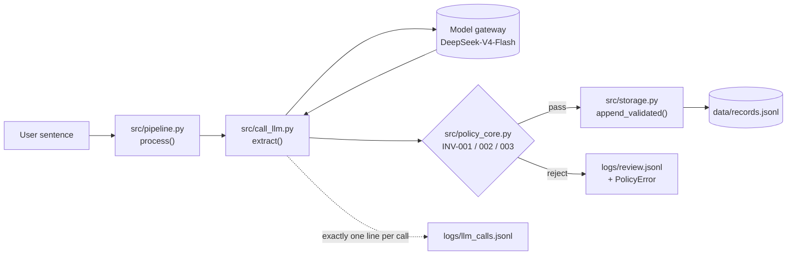
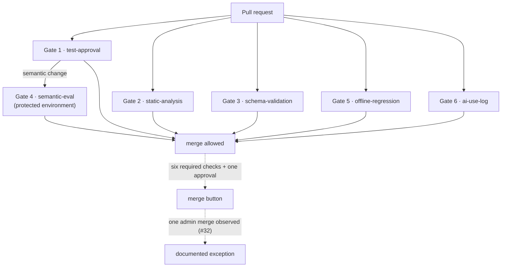

# CS5351 Agentic Software Engineering Project — Team Report

**Project:** AI-Powered Personal Finance Assistant — one natural-language sentence in, one validated spending record out.
**Repository:** https://github.com/Felix-Free/AI-Finance-Assistant
**Course:** CS5351 Agentic Software Engineering · City University of Hong Kong
**Submission date:** 22 November 2026
**Baseline:** `main` at `20417a7` · 239 commits · 59 merge commits · development window 6–22 November 2026
**Length:** approximately 9,100 words excluding diagrams and tables.

---

## Team

| Role | Member | Student ID | Owned deliverables | Contribution weight |
|---|---|---|---|---|
| A — Leader | Tan Jingling | 60528523 | Integration, cross-review, `Report.md`, `Prompt.md`, repository and CI configuration | 1.09 |
| B — Requirements & Architecture | Qingzhi Lu | 60357951 | D1 requirements registry, D2 architecture artefacts, trace matrix | 0.86 |
| C — Security & Policy | Qiang Wanyun | 60339160 | Invariants, runtime policy catalog, permission model, agent governance | 0.86 |
| D — Implementation | Liu Wanyang | 60915652 | `src/**`, storage, measurement scripts, ADRs, memory design | 1.17 |
| E — Verification & QA | Chen Guanyu | 61049313 | `test/**`, the six CI gates, review memo, bug diary, debt register | 1.02 |

The relative contribution weights in §12 are computed from recorded man-hours (mean 1.0; weight = member
hours ÷ team mean) and pro-rate the individual mark, as required by the course brief.

---

## 1. Introduction and project overview

The application turns one sentence a person would actually type — *"I spent 350 on groceries"* — into one
structured, validated spending record: an amount, a category from a closed vocabulary, a running total, and a
budget decision. Everything between those two points is the project.

The interesting part is not the extraction. It is the question of what happens when the extraction is wrong.
Large language models are fluent and unreliable in the same breath: they invent categories, wrap JSON in
prose, and answer a purchase description with a confident fabrication. A personal-finance assistant that
writes such an output into a ledger is worse than no assistant at all. The architecture is therefore built
around one separation:

> **The model proposes; deterministic code disposes; humans own the difference.**

The model (`DeepSeek-V4-Flash`, reached through a single module, `src/call_llm.py`) produces a *proposal*.
`src/policy_core.py` validates that proposal against three invariants written in code — a finite positive
amount with at most two decimals (`INV-001`), a category drawn from a closed whitelist (`INV-002`), and a
cumulative spend that does not exceed the budget (`INV-003`). Only a record that survives those checks may
reach `src/storage.py`. A rejection is not an exception to be swallowed; it is the system working, and it is
recorded. No business rule is ever enforced by prompt text, and no model output ever reaches disk without
passing the deterministic layer.

This is a genuine AI component rather than decoration. The input is free-form natural language in Chinese and
English; the same purchase appears as *"lunch"*, *"groceries"*, *"the electricity bill"* or *"I paid 35.50 for
lunch"*. The live evaluation set in `test/live/test_live_model.py` includes the cases that broke a
first-generation prompt: *"My bus fare cost 12"* (the model wants to say `transportation`) and *"I spent 90 on
groceries"* (the model wants to say `groceries`). A regular expression does not survive that corpus; a model
does, provided code constrains what it may conclude.

Scope is stated as much by what the system refuses to do. The registry's `non_goals` are explicit: no bank or
aggregator connections (`NG-1`), no payments (`NG-2`), no investment advice (`NG-3`), no automatic transfers
(`NG-4`), no tax or forecasting features (`NG-5`), and no feature that is not approved in the registry
(`NG-6`). The system is a parsing-and-validation service with an audit trail, not a financial adviser.

The repository delivers the nine artefacts the brief asks for. D1 is the machine-readable requirements
registry (`docs/req/requirements.yaml`, validated against `req-schema.json`). D2 is eleven architecture
artefacts: the blueprint, four decision records, the invariant register, the trace matrix, the memory design,
the permission model, the runtime policy catalog, the candidate evaluation table, the evaluation logbook, the
risk list and the option ledger. D3 is the coding governance set (`AGENTS.md`, the structural constraints,
the MCP tool manifest, the OpenCode permission model and the always-on rules). D4 is verification governance
(the verification constraints, the review memo, the debt register, the bug diary). D5 is the annotated agent
session transcripts. D6 is this report. D7 is the GitHub repository with a CI/CD pipeline and blocking gates.
D8 is the source and the test suites. D9 is the static prompt and its versioned runtime history. The rest of
this report is about how those artefacts were produced, what they prove, and where they fall short.

**Figure 1 — the two-half architecture.**

Two logging streams run alongside the data path and are part of the safety property rather than an
afterthought. `logs/llm_calls.jsonl` receives exactly one line per model call — input, raw reply, parsed
object, error, identifiers and token usage — and the call is treated as failed if that line cannot be
written (`RP-004`, fail-closed). `logs/review.jsonl` receives every policy rejection with its short error
code. The audit trail is therefore complete by construction: there is no code path that calls the model
without logging, because the only code path that can call the model is `src/call_llm.py`.

---

## 2. Team, roles and the engineering process

### 2.1 Roles and ownership

Five roles, one member each, with rotating review rather than rotating authorship: A led integration and
cross-review; B owned requirements and architecture; C owned the security and policy documents; D owned the
implementation; E owned verification and the CI gates. Ownership is a statement about *responsibility*, not
about *write access* — the two are deliberately separated. `docs/architecture/permission-model.md` §2 and
`.opencode/permissions.jsonc` define what the agent may read and write, defaulting to deny and whitelisting
each path. `docs/req/**`, `.opencode/**`, `.agent/**`, `.github/**`, `transcripts/**` and `logs/**` are
human-only; `src/**` and `test/**` are writable inside an approved task; `.env` is readable by nobody.

The separation proved its worth repeatedly. The clearest case is role B's agent editing `.github/workflows/ci.yml`
to fix a runner problem: the change was technically correct and entirely outside B's authority. The
transcript (`transcripts/60357951-QingZhi LU.md`) records the challenge — *"which role owns this document?"* —
and the agent's admission that the path was human-only. A single ownership table in `AGENTS.md` §3 turned a
silent boundary violation into a two-line conversation.

### 2.2 The three phases

**Phase 1 (6–13 November)** established the skeleton and the governance documents: the agent contract
(`AGENTS.md`), the structural constraints, the requirements registry, the security specifications
(invariants, runtime policy catalog, permission model) and the deterministic core. The deterministic layer
established in this phase is what most of the 22 implemented-and-tested requirements now rest on.

**Phase 2 (13–20 November)** built the system around that core: the storage layer with atomic appends, the
token and latency measurement scripts, the six-gate CI pipeline, the review memo, the debt register and the
bug diary, and the Phase 2 architecture set (ADR-001 and ADR-002, the risk list, the option ledger, the
evaluation table, the trace matrix rework).

**Phase 3 (19–22 November)** hardened what the earlier phases had only claimed: concurrent appends
(ADR-003), log redaction and budget re-checking under the storage lock (ADR-004), the test-approval gate's
behaviour across upstream syncs, the requirement-approval evidence, and the reporting infrastructure itself.

The numbers are ordinary but they are the honest record: 239 commits and 59 merge commits over seventeen
days, of which the majority are small, reviewable changes rather than large drops.

| Phase | Window | What it added | Evidence |
|---|---|---|---|
| Phase 1 | 6–13 Nov | skeleton, governance, deterministic core, requirements | `AGENTS.md`, `docs/architecture/invariants.md`, `src/policy_core.py` |
| Phase 2 | 13–20 Nov | storage, measurement, six gates, Phase 2 architecture set | `.github/workflows/ci.yml`, ADR-001/002, `docs/review-memo.md` |
| Phase 3 | 19–22 Nov | atomic append, log redaction, gate hardening, report | ADR-003/004, `.github/ci_checks.py`, `Report.md` |

### 2.3 The per-task protocol

Every task followed the same five steps, and the second one is the point of the whole exercise:

1. **Understand and restate.** The agent restates the task and names ambiguities. If the task implies a
   requirement that is not in the registry, it stops rather than inventing one.
2. **Plan, then wait.** The plan lists files to read, files to change, the requirement IDs, the security
   impact and the test plan — and then the agent **stops**. No edit happens before a human approves.
3. **Implement one task at a time.** No bundling, no silent refactoring, no new dependency without approval.
4. **Verify.** Run the relevant tests, cover negative cases, and confirm that each new guard has a test that
   fails when the guard is removed.
5. **Report.** End with a `CHANGED FILES` block that must match `git status`, plus reason, requirements,
   commands run, truthful results and remaining risks.

The protocol is enforced socially, not mechanically, and that is its weak point — but two parts of it became
mechanical later: the plan-first rule is restated to the agent on every task through `Prompt.md`, and the
`CHANGED FILES` claim is checked against the diff by whoever reviews the pull request.

### 2.4 How the process was optimised

Three changes earned their place.

**The AI-use log became a gate instead of an honour system.** A log that is updated "when convenient" is a
log that documents the easy sessions. Gate 6 now fails any pull request that touches `src/`, `test/`,
`prompts/`, `.github/`, `scripts/`, `requirements.txt`, `Prompt.md` or `pytest.ini` without appending a new
session key, and it fails any pull request that edits or removes an earlier row. The log went from 0 to more than seventy sessions and, more importantly, from unverifiable to checkable.

**Test-first moved from discipline to a merge condition.** Gate 1 initially existed only as a rule; the team demonstrated it could be satisfied by an approval on a *documentation* commit (BUG-01). The gate was then tightened to require a commit that changes tests and nothing else. That tightening immediately blocked the leader's own merge of PR #20 — the clearest possible evidence that the gate is not decorative.

**Review was parallelised by role, with integration serialised.** Five members reviewed their own areas in parallel while integration stayed with one person, so every merge had at least one reviewer who had read the whole diff. Across the project that produced thirty reviews on thirty-three pull requests — nineteen approvals, seven change requests and four comments — and thirty-three of the fifty-nine merge commits on `main`.

**Figure 2 — the pull-request gate pipeline.**

The dotted edges record what the gates now require: six gates that exist, run, and are required on `main`, with administrator bypass disabled. One merge was completed while Gate 1 was red (#32), and it is kept as a dated exception. That episode is treated as a first-class piece of evidence in §6.2 and §9, not as an embarrassment to be omitted.

---

## 3. Requirements engineering and requirement volatility

### 3.1 A machine-readable registry

The requirements live in one file, `docs/req/requirements.yaml`, and one schema, `docs/req/req-schema.json`.
The registry holds **36 formal requirements**: eight functional (`FR-001`..`FR-008`), seven non-functional
(`NFR-001`..`NFR-007`), three business invariants (`INV-001`..`INV-003`), eight AI-behaviour requirements
(`AI-REQ-001`..`AI-REQ-008`), five error-class requirements (`ERR-001`..`ERR-005`) and five security
requirements (`SEC-001`..`SEC-005`). Each entry carries an identifier, a type, a statement, a
**machine-checkable fit criterion**, a MoSCoW priority, an owner and a status.

Two design choices matter more than the field list.

**The fit criterion is written to be checkable, not to be admired.** A functional requirement such as
`FR-004` ("spending category validity check") names the enforcing function
(`src/policy_core.py::enforce_category`), the closed vocabulary, and the observable outcome — a rejection with
`code="policy:category"` and `review=true`. A non-functional requirement such as `NFR-007` names the test file
and the rule that each guard must have a test that fails when the guard is removed. A requirement whose
criterion cannot be checked is a wish, and the schema makes that visible.

**`pending_confirmation` is a first-class status.** Fifteen status fields in the registry are not
`approved`. Eight of them are collected as formal open decisions, `PD-001`..`PD-008`, each with a question,
an owner and a verification method — for example `PD-002` ("is the current eight-value category whitelist
final?") and `PD-007` ("what latency and token thresholds are approved?"). The registry states explicitly
that a `pending_confirmation` item must not be read as approved. This convention did real work: when the
team later wrote the evaluation logbook, `NFR-001` and `NFR-002` could not be quietly marked "met" because
their thresholds are `null` and their measurements were never committed.

The registry is enforced in CI by Gate 3, which validates it against the Draft 2020-12 schema on every pull
request. Deleting a required field makes the gate fail; that negative case is part of the gate's own
evidence. The schema therefore protects the *shape* of the registry, and the trace matrix (§4.4) protects
its *meaning*.

### 3.2 Requirement volatility — quantified

Volatility is not a complaint, it is a measurement. Between 10 and 18 November the registry changed in
**ten commits**, and the trace matrix in seven. The changes fall into four kinds, and the distinction
between them is the interesting part.

| Kind of change | Evidence | What it cost |
|---|---|---|
| Identifier rename | `C-INV-###` → `INV-###` (`06c41d1`, `4f346b7`) | every downstream reference in requirements, blueprint, invariants and code had to be found and rewritten; a partial rename would have made the trace matrix lie |
| Criterion refinement | `NFR-007` testability rewritten (`dee59f7`); `NFR-001/002/006` descriptive fields corrected (`5dee306`) | reviewers had to re-read the acceptance criteria, not just the requirement text |
| Counting correction | the "37-row" tally corrected to **36 formal requirements** + one excluded placeholder (`INV-PENDING-01`) | a document that adds up wrongly is worse than a document that is short |
| Scope discovery | eight `PD` decisions opened rather than guessed | each one became a visible, owned question instead of an assumption in code |

Two lessons are worth recording. First, **the cheapest volatility was the one that was decided early**: the
three invariants (`INV-001`/`002`/`003`) never changed after Phase 1. They were specified precisely enough —
finite positive amount with at most two decimals; category drawn from a closed whitelist; cumulative spend
not exceeding the budget, equality allowed — that implementation, tests, prompt text and documentation could
all be written against a stable target. Second, **the most expensive volatility was naming**, because names
are what other artefacts point at. The rename was mechanical but not local: it touched four documents and the
code, and it is exactly the kind of change an agent will do partially unless the reviewer checks every
reference.

Volatility was also not uniformly bad. The registry grew a `status` vocabulary that distinguishes
`IMPLEMENTED_AND_TESTED` from `IMPLEMENTED_NOT_TESTED`, `PARTIALLY_IMPLEMENTED` and `NOT_VERIFIED`, and the
current distribution over the 36 formal requirements is:

| Verification status | Count | Examples |
|---|---|---|
| `IMPLEMENTED_AND_TESTED` | 22 | `FR-001`..`FR-008`, `INV-001`..`INV-003`, `AI-REQ-001/002/003/004/006/007`, `ERR-001/002/003/005`, `SEC-003`, `NFR-007` |
| `IMPLEMENTED_NOT_TESTED` | 5 | `AI-REQ-005`, `AI-REQ-008`, `SEC-002`, `ERR-004`, `SEC-005` |
| `PARTIALLY_IMPLEMENTED` | 6 | `NFR-003`, `NFR-004`, `NFR-005`, `NFR-006`, `SEC-001`, `SEC-004` |
| `NOT_VERIFIED` | 3 | `NFR-001`, `NFR-002`, and the non-formal placeholder `INV-PENDING-01` |

That table is the project's most useful single page of self-assessment. It says, without decoration, that
roughly three fifths of the requirements are implemented and tested, that five are implemented but not
covered by a test that would notice their removal, that six are partial, and that the two performance
requirements have no committed evidence at all. A report that presented this as "all requirements met"
would be contradicted by its own repository in one `grep`.

### 3.3 Ambiguity resolution

Ambiguity was handled by making it explicit rather than resolving it by assumption. Three examples show the
loop from ambiguity to artefact.

**The category whitelist (`PD-002`).** The implementation defines eight categories — `food`, `transport`,
`shopping`, `entertainment`, `housing`, `utilities`, `health`, `other` — and the prompt, the tests and
`policy_core` all depend on that set. Whether the set is *final* is a product decision, not an engineering
one. Rather than freezing it silently, the registry records `PD-002` as pending, owned by role C, with the
verification method "C confirms in `invariants.md`; E tests every member". The consequence is visible in the
trace matrix: the whitelist membership is exercised by tests, but its finality is marked
`NOT_VERIFIED` under a placeholder row that is excluded from the formal count.

**The budget value and its storage (`PD-003`).** `INV-003` compares cumulative spend to a budget, but what
that budget is, over what period, and where it is stored were never specified. The registry records the
question and the honest current answer: the budget limit is passed in by the caller, and no storage or
configuration layer exists. That single sentence prevented a whole class of false claims — the system cannot
"enforce the user's budget" if it does not know the user's budget, and saying so is more valuable than
pretending otherwise.

**The metric thresholds (`PD-007`).** `NFR-001` (latency) and `NFR-002` (token usage) are expressed as
metric + threshold + verification, as the brief requires, but the thresholds are `null` because no approved
budget exists. The evaluation logbook therefore records both as `pending` and explicitly forbids substituting
pytest duration for measurement. This is the least satisfying outcome in the project and the most honest:
the measurement code is merged (`scripts/measure_latency.py`, `scripts/measure_tokens.py`,
`src/report_tokens.py`), the procedure is written down, and the number is missing.

The loop that connects these is deliberate: an ambiguity noticed in review becomes a `PD` item; a `PD` item
becomes either a requirement change (which Gate 3 revalidates) or a documented risk; and the trace matrix row
records which of the two happened. The loop is slow, and that is the point — it converts "we think the budget
is 500" into "the budget is a caller parameter, and here is the row that says so".

---

## 4. Architecture and design decisions

### 4.1 The authority boundary

The architecture has one non-negotiable property: **no model output is authoritative**. It is implemented in
three places, each of which would have to fail for a bad record to reach disk.

1. **`src/policy_core.py` validates before anything is written.** `validate_record(raw, spent, budget_limit)`
   checks that the payload is a mapping, then applies `INV-001` (amount), `INV-002` (category) and `INV-003`
   (budget) in a fixed order, stopping at the first failure and raising `PolicyError(code, review)` with a
   short code — `policy:amount`, `policy:category`, `policy:budget` — and a `review` flag that tells the
   caller whether a human should look at it.
2. **`src/storage.py` re-validates and re-reads under a lock.** A record that arrives at the storage layer is
   checked again, and — since ADR-004 — the budget decision is taken against the *persisted* total inside the
   writer's lock, not against a caller-supplied number. The caller's `spent` is an advisory pre-check.
3. **`src/call_llm.py` is the only module that may speak to the model.** No other module imports a transport
   library; Gate 2 scans for exactly that. Every call logs exactly one line, and a call whose log line cannot
   be written is treated as failed rather than successful (`RP-004`).

The rule that ties these together is stated in the runtime policy catalog and repeated in `AGENTS.md`: **no
business rule may be enforced by prompt text.** The prompt describes the contract; the code enforces it. This
is not stylistic. A prompt is an instruction to a probabilistic system and can be ignored, paraphrased or
overridden; a guard is a branch that raises.

### 4.2 Decisions that were actually hard

Four architecture decision records carry the reasoning, and each one rejected a plausible alternative.

**ADR-001 — the layered context structure.** What the model receives on every turn is assembled deliberately:
identity and standing constraints, the task, the current sentence, and — after any compaction — a
re-injected set of constraints. The alternative, a single accumulating conversation, was rejected because
compaction silently drops the rules that matter most: the constraint that survives longest in a growing
context is the one nobody restated. The consequence is a small assembly pipeline whose inputs can be
inspected, at the cost of a longer prompt on every call.

**ADR-002 — the token-budget cap.** The cap, the compaction threshold and the drop order are fixed in the
design rather than tuned at runtime. The numeric value is marked **Pending PD-007**, which is unusual for an
ADR and deliberate: writing a number that nobody approved would have turned a design question into an
undocumented decision. The rejected alternative was an adaptive budget that shrinks under load — it is
cheaper, but its behaviour cannot be replayed, and a system whose safety argument depends on replay should
not have a tuning parameter in the middle of it.

**ADR-003 — atomic append and locking.** The original writer appended to `data/records.jsonl` directly. E
reproduced two failures: an interrupted append left **16 bytes** behind, and two concurrent writers sharing a
fixed temporary file lost a record that had been reported as written. The decision was a unique temporary
file, `fsync`, an atomic replace, and a sidecar lock covering read, duplicate check, budget check, write and
replace. The rejected alternatives are instructive: "retry on failure" does not help when the failure is a
partial write that the process no longer knows about, and "accept last-writer-wins" was rejected because a
record that reported success and then disappeared is a worse failure than an error.

**ADR-004 — budget authority and audit redaction.** Two problems surfaced in the final audit. First, budget
authority: `INV-003` must be decided against what is actually persisted, so the locked total inside
`storage._append_from_pipeline` is authoritative and the pipeline's read is only a pre-check. Second, audit
safety: `logs/llm_calls.jsonl` must not carry user text, raw model output, amounts or IO details, so `input`
and `raw` are written as `redacted:len=<n>`, `parsed` is `None` on every path, and only short safe error codes
survive. The rejected alternative was a public "recompute" flag on `append_validated`; it was refused because
a flag is a door, whereas a module-private `_PIPELINE_ORIGIN` sentinel is a key that only one caller holds.

A fifth record, `adr/phase2-ci-verification.md`, documents why CI is two workflows with six independent PR
jobs and two branch jobs, and why a workflow-level `paths:` filter was rejected: such a filter skips the whole
workflow, which would hide the approval gate entirely.

### 4.3 Invariants and degradation behaviour

The three invariants are stated once, in `docs/architecture/invariants.md`, and are referenced — never
restated — everywhere else.

| Invariant | Statement | Enforcer | Verification |
|---|---|---|---|
| `INV-001` | amount is a finite positive number with at most two decimals | `policy_core.enforce_amount` | boundary and negative tests in `test/offline/test_invariants.py` |
| `INV-002` | category is drawn from the closed whitelist, case-sensitively | `policy_core.enforce_category` | every whitelisted value accepted; out-of-vocabulary values rejected |
| `INV-003` | cumulative spend ≤ budget, equality allowed | `policy_core.enforce_budget`, re-checked under the storage lock | equality accepted; one cent over rejected with `review=true` |

Each invariant has an operational fallback that says what the system does when it is violated — reject, log
one line with a short code, and for category and budget set `review=true` so the case reaches a human. The
fallback is a concrete action, not "fix the bug", which is the distinction the brief asks for.

Degradation is catalogued as `RP-001`..`RP-007`: invalid JSON from the model (`RP-001`), configuration,
transport or protocol failure (`RP-002`), invariant violation (`RP-003`), logging integrity (`RP-004`),
budget exceeded (`RP-005`), category out of vocabulary (`RP-006`), and storage boundary failure (`RP-007`).
The direction of every policy is the same: **when in doubt, deny**. A transport failure does not retry
silently; a non-JSON reply is logged and re-raised; a failed budget write leaves the ledger untouched.

The permission model applies the same instinct to the agent itself. Default deny, every path whitelisted
explicitly, secrets unreadable, `.github/**` and `.opencode/**` human-only. The exception process is written
down: if a task genuinely needs a forbidden path, the agent states the path and the reason in one sentence,
waits for explicit human approval, makes the smallest change, and marks it `(approved exception)` in its
report. An agent cannot grant itself an exception, and that asymmetry is the whole design.

### 4.4 Traceability

`docs/architecture/trace-matrix.md` joins every formal requirement to an enforcing component, a test, and a
runtime monitor. It is the artefact that turns "we said we built it" into "here is the line that proves it".

Its honesty is in what it refuses to fill in. The Runtime Monitor column is `—` for every row, because no
continuous monitor exists: log files are outputs, not monitors. Rather than inventing a monitor to complete
the grid, the matrix states the gap. Likewise, a requirement is `IMPLEMENTED_AND_TESTED` only when its cited
test is on `main`; evidence that exists only on a branch is labelled `PENDING_MERGE` in the remarks and never
promoted to the status column. Those two conventions are why the distribution in §3.2 can be trusted as a
description of `main` rather than of the team's hopes.

The matrix also records the known gaps in one place: no committed latency or token measurement, an untested
fail-closed logging branch, no automated secret scan (manual verification only), and only `policy_core`
import-checked for the single-entry-point rule. Each gap names an owner, which is the difference between a
known limitation and an unknown one.

---

## 5. AI-assisted construction and prompt evolution

### 5.1 The supervised construction pipeline

The agent was never asked to build the system. It was asked to perform one bounded task at a time, under four
hard limits that no prompt can relax: never change the model or the gateway, never bypass `policy_core`,
never write a secret, never touch a path outside the whitelist. Those limits are expressed as code,
configuration and structure — a schema, a permission file, a single transport module, a scan in Gate 2 — not
as requests in a prompt that the model may ignore.

A worked example shows the shape better than a summary. The concurrency defect behind ADR-003 began as a
review observation ("two writers can lose a record") and ended as a merged change with three parts:

1. **A failing test first.** E wrote a regression that reproduces the lost record and the 16-byte partial
   write; the test failed for the right reason, and the failure was recorded.
2. **A design decision, not a patch.** D compared three locking designs and asked the agent to argue for
   each; the chosen one covers read, duplicate check, budget check, write and replace under a single sidecar
   lock. The rejected option — "retry on failure" — is written down in ADR-003, because the value of a
   decision record is mostly in what it says no to.
3. **A review that found the second-order problem.** The first implementation used `warnings.warn` for a
   post-commit unlock failure. With `-W error`, a warning becomes an exception, and an append that had
   already committed would have looked failed to its caller. The fix was a module logger, and the reason is
   now part of the code review checklist.

Scale is worth stating plainly, with the caveat that counts are not quality: 239 commits and 59 merges over sixteen days; 65 logged AI sessions; 36 formal requirements; nine deliverables; 164 offline test functions; six CI gates and two branch jobs.

### 5.2 Prompt evolution: v1.0 → v1.1

The prompt history is kept at `prompts/prompt_v1.1.yaml`, and it is the project's cleanest case of an AI
failure that a human diagnosed and turned into a specification change.

**v1.0** asked, in two sentences, for a JSON object with `amount` and `category`. It named no vocabulary and imposed no output discipline.

**What went wrong on the live gateway.** The model returned `transportation` instead of `transport`, and
`groceries` instead of `food`. The safety layer behaved correctly — `INV-002` rejects any label outside the
whitelist — but each rejection consumed a model round trip and pushed the sentence into the review path. The
system was safe and wasteful at the same time, which is exactly the failure mode a deterministic boundary
makes visible instead of hiding.

**v1.1** pins the output shape (one JSON object, no prose, no code fences), quotes the eight-value whitelist
verbatim, maps the obvious synonyms explicitly ("use `transport`, not `transportation`; `food`, not
`groceries` or `dining`"), forbids extra keys, and defines the non-spending branch: return exactly
`{"error": "not_a_record"}`. The prompt now speaks the same language as `policy_core.py` — but it still only
*describes* the rules. Enforcement remains in code, and a test
(`test/offline/test_prompt_contract.py`) asserts that the production system prompt names every whitelisted
category and keeps the `not_a_record` branch, so the prompt cannot silently drift from the vocabulary the
code enforces.

**A second defect, found later, was structural rather than semantic.** PR #28 added the versioned prompt file
in the shape a human would write for documentation: a `prompts:` list containing both versions. Gate 4
failed in *zero seconds* — before any network call — because the live fixture reads a **top-level**
`system_prompt` key (`test/live/test_live_model.py:87`) and received `None`. The fix was thirty-seven lines:
expose the current prompt at top level and keep it byte-identical to the history entry. Two lessons came out
of it. First, a gate that replays an artefact needs a test that validates the artefact's *shape*, and none
existed — the prompt file was the only configuration file in the repository with no contract test. Second,
the zero-second failure was a gift: it proved the gate was checking the file rather than the model, and it
took one read of the fixture to see why.

**What the pair of defects says about prompt engineering.** A prompt is a specification with a token cost and
a shape. Making it stricter converted a correctness problem into a cheaper one — fewer rejected records,
fewer retries — but it did not make the system safe: the deterministic layer had already made the
hallucination survivable. The order of the two layers is what allowed a prompt bug to be an inconvenience
rather than a data-integrity incident.

### 5.3 Review as a product, not a formality

Reviews in this project had a fixed, short checklist, and each item exists because it caught something real.

| Check | What it caught |
|---|---|
| Does the plan match the diff? | scope creep hidden inside an approved plan |
| Does `CHANGED FILES` match `git status`? | files edited but not reported, and vice versa |
| Was a read-only path touched? | role B editing `.github/workflows/ci.yml`; the agent admitted the path was not its own |
| Does the new test fail when the guard is removed? | a "negative" test that passed without the guard — the guard was never exercised |
| Is any rule enforced by prompt text rather than code? | a proposed enforcement that lived only in the prompt |

Review verdicts were not always approvals. `docs/review-memo.md` records `CHANGES REQUIRED` for PR #18
(storage/spend defence) and PR #19 (policy and contract alignment), with the open findings listed: an
interrupted append leaving partial bytes, and an uncleaned HTTP error body reaching the call log. Neither was
closed by describing it. Both later became bugs with regression tests and, eventually, merged fixes.

The most useful review habit turned out to be **asking the agent to prove a negative**. A green suite is
evidence that the happy path works; it is not evidence that a guard exists. The team's convention became:
disable the guard, run the test, watch it fail, re-enable. That is a thirty-second check that distinguishes
a test from a decoration, and it is now a written rule in `docs/code-governance/verification-constraints.md`.

---

## 6. Verification and quality governance

### 6.1 The six blocking gates

The pipeline is two workflows: `ci.yml` runs six independent jobs on every pull request, and `branch-ci.yml`
runs static analysis and the offline suite on every push. The gate *logic* lives in one helper,
`.github/ci_checks.py`; the workflows own orchestration. Keeping the decisions in one file is why the gates
can be unit-tested offline at all.

| Gate | What it blocks | How it decides | Known weakness |
|---|---|---|---|
| 1 · test-approval | implementation without a prior human approval on a test-only commit | reads GitHub review state; the approved commit must change tests and nothing else, and must precede the first implementation commit | one merge observed with the gate red (#32); required on `main` since 23 November (see §6.2) |
| 2 · static-analysis | a second model entry point, an API-shape change, a missing ADR for a security-critical path, a credential in a tracked path | `ruff`, `mypy`, `pip check`, a secret scan, an AST scan of transport imports, permission-path checks | `mypy` runs over `src` only; the secret scan inspects paths and content patterns, not history |
| 3 · schema-validation | a registry that no longer validates | Draft 2020-12 validation of `requirements.yaml` against `req-schema.json`, and of the schema itself | validates shape and required fields, not meaning |
| 4 · semantic-eval | a prompt or model change that degrades extraction quality | replays the live extraction set in the protected `semantic-eval` environment, five cases including the `not_a_record` branch | runs only when Gate 1 flags a semantic change; credentials are a single point of failure |
| 5 · offline-regression | any regression in the deterministic suite | full `pytest test/offline` | offline only; transport paths are simulated |
| 6 · ai-use-log | a change to code, tests, prompts, workflows or scripts with no logged session, or an edit to an earlier session | parses the log as a list of keyed rows and compares against the merge base | verifies presence and immutability, not the quality of the entry |

The gates are independent by construction: each is a separate job with its own status, and a failure in one
does not cancel the others. Gate 4 is the only job with a dependency — it `needs:` Gate 1, because the
decision "is this change semantic?" belongs to the gate that reads the diff, not to the evaluation job.

### 6.2 Enforcement versus intention

The six gates exist, run on real pull requests, and have produced real verdicts — Gate 4 has executed live evaluations in the protected environment (five cases passing on the PR #20 path), and Gate 1 has blocked the leader's own merge. Since 23 November they are also *required* checks on `main`: the merge button stays disabled until every required check passes and one approval is recorded, and administrator bypass is disabled in the branch rule.

That gap was real and is now closed. `DEBT-08` tracked it, and the acceptance test it named was run: a deliberately failing pull request ([#50](https://github.com/Felix-Free/AI-Finance-Assistant/pull/50)) is kept as evidence — Gate 1 failed on the missing test-first approval, Gate 2 on a second model entry point and Gate 6 on the missing session, and GitHub left the merge button disabled with **Required checks failing** and **1 approval required**.

Three things follow, and the report states them plainly because a reader who checks the repository will find them anyway:

1. **The pipeline is implemented, demonstrated and now enforced.** The merge button was observed disabled on a pull request whose required checks failed, and on any pull request without an approval; administrator bypass is disabled.
2. **One documented exception does not establish a policy.** The #32 exception is recorded in the review memo and in `DEBT-08`; it does not mean the six gates are optional.
3. **The remediation is recorded, not promised.** The branch rule, the failing demo pull request and the closed `DEBT-08` entry together are the acceptance test for D7.

### 6.3 What was actually run

Every number below was observed by a team member; the command and the state of the tree are given so the
claim can be re-run rather than trusted.

| What | Command / environment | Result | Where it is recorded |
|---|---|---|---|
| Offline suite | `pytest test/offline -q`, network blocked | 211 collected cases passed on `main` at `35f580d`; the suite now holds 164 test functions | `docs/bug-diary.md`, PR #34 evidence |
| Live semantic set | `pytest test/live/test_live_model.py` in the protected environment | 5 passed, including the `not_a_record` case | Gate 4 run on the PR #20 path |
| Static analysis | `ruff check --select E9,F63,F7,F82`, `mypy --disable-error-code import-untyped src` | clean across eight source files at `df729a9`; later eleven | `docs/measurements/phase2-qa-evidence.md` |
| Schema | Draft 2020-12 validation of `requirements.yaml` | pass; deleting a required field fails | Gate 3 |
| Guard-removal negatives | one invariant at a time, guard disabled | the corresponding test fails in each case | `docs/measurements/phase2-qa-evidence.md` §2 |
| Atomic append | fault injection at the replace step, plus three concurrent writers | original bytes preserved on failure; both concurrent records retained | `test/offline/test_phase3_concurrency.py` |

The list of things that were **not** run is equally important: no merge-time live execution against the protected environment, and no committed latency or token measurement. Required-check enforcement and the blocked pull request are no longer on this list (§6.2).

### 6.4 Defect trends and the debt register

Four defects were recorded, and they are four different failure modes rather than four instances of one.

| Bug | Symptom | Mode |
|---|---|---|
| `BUG-01` | Gate 1 accepted an approval on a documentation-only commit | a gate that was *green* and wrong |
| `BUG-02` | an offline budget test wrote into the repository's `logs/` | a test that passed while mutating runtime state |
| `BUG-03` | an interrupted append left 16 bytes behind | a stated safety boundary not enforced by the writer |
| `BUG-04` | an uncleaned HTTP error body reached the call log | a secrecy rule violated by a logging convenience |

The trend is visible in the sequence. The early defects were **specification gaps** — a rule written in prose
that no code enforced, a test that measured the wrong thing. The later defects were **stress and secrecy
failures** — concurrency, partial writes, unredacted bodies. That is the point at which human review adds the
most value, because the agent's tests were green and its implementation was plausible in both cases. The
concurrency bug was found by a reviewer reproducing a lost record, not by reading the diff; the redaction bug
was found by a synthetic marker that made a real logging shortcut visible.

The debt register tracks the same work as debt against eight AI-era categories, and its most useful property
is that **"monitored" is not "clean"**. Guardrail debt, evaluation debt, human/cognitive debt and prompt rot
are *active*, each with a reproduced item and an owner. Four categories are *monitored* with no reproduced
item: hallucinated dependencies, untouchable code (closed after the mypy fix), hidden dependencies
(transport confined to one module), and agent-induced bloat. Naming a category "monitored" keeps it visible
without claiming it is empty.

Two status lines in the register lag behind `main`, and the report corrects them rather than repeating them:
`BUG-03` and `BUG-04`, and therefore `DEBT-01` and `DEBT-02`, were fixed on `main` — atomic append via
PR #30, log redaction and budget re-checking under the lock via PR #38 — but the diary and register still
carry "pending main" against them. The fixes are verified by tests named in the entries; the labels simply
have not been refreshed. `DEBT-08` (required-check enforcement) was the last substantial open item and is now closed against the blocked pull request in §6.2, and `DEBT-03` (guard-removal negatives observed only locally) is open in the narrow sense that the negatives have not been re-run inside hosted CI.

---

## 7. Human oversight: what the agent got wrong

The brief asks what human oversight caught that the agent did not. The honest answer is a list of incidents,
each of which changed something in the process afterwards.

**1. The scaffold that omitted the governance it was governed by.** The initial skeleton (PR #6) created the
source tree, the tests and the documentation directories, and left out `.github/workflows/`, `.opencode/` and
`.agent/` — the three directories whose absence would have made the governance documents unenforceable. The
agent had optimised for the files it was asked about. The human added them by hand and then made the required
tree an explicit checklist item.

**2. A gate that was green and wrong.** Gate 1 accepted an approval recorded on a commit that changed only
documentation. The gate "worked" — it found an approval from a non-author member — and it proved nothing,
because the approval was not on a test. This was found by adversarial review, not by a failing test
(`BUG-01`). The fix made the gate require a commit that changes tests and nothing else.

**3. A passing test that mutated runtime state.** An offline budget test wrote a line into the repository's
`logs/` directory. The suite was green, the exit code was zero, and the deterministic test had a side effect
on runtime evidence (`BUG-02`). Nobody found this by reading the assertion; it was found by looking at the
filesystem after a run. The fix pointed the test at `policy_core` directly and added a sentinel-bytes
regression that fails if `logs/` or `data/` changes.

**4. A concurrency failure the agent's tests could not see.** The first atomic-append implementation used a
fixed temporary file and no lock. A reviewer reproduced the failure: two writers shared the temporary file,
one reported success, and its record vanished. The agent had not considered that two writers could read the
same old state, because its tests ran one at a time (`BUG-03`, ADR-003). The fix required a unique temporary
file and a sidecar lock, and the reviewer demanded the reproduction before accepting it.

**5. A logging shortcut that leaked a response body.** On the HTTP-failure path, the error field carried the
uncleaned response body. A synthetic sensitive marker made the leak visible; the rule that came out of it is
general — no error log field may carry an uncleaned body, ever (`BUG-04`, ADR-004). The eventual fix redacts
`input` and `raw` to a length marker and stores `parsed: None` on every path.

**6. The gate that blocked its own author.** Gate 1 refused the leader's merge of PR #20 with
`FAIL: no approval on a qualified test-first commit`. The first reading was a CI synchronisation bug; the
second was that a strict test-first rule cannot be satisfied by a pull request that arrives with tests and
code together, which is how a five-person team works under a deadline. The resolution was not to weaken the
gate but to add a one-time, labelled, documented waiver scoped to that single pull request — recorded in
`adr/phase2-ci-verification.md` and covered by its own regression test.

**7. An exception that became evidence.** PR #32 was merged with Gate 1 red. The decision was taken by a
human, under deadline pressure, and it is recorded as an exception rather than smoothed away (`DEBT-08`).
Oversight includes recording your own exceptions; the alternative is a repository whose history implies a
discipline it did not have.

The generalisation the team arrived at is uncomfortable but useful: **the agent is locally fluent and
globally unaware.** It satisfies the sentence it was given, competently and quickly, and it misses the
invariant nobody mentioned — the directory that has to exist, the second writer, the log field that is also
evidence. Human value in this project sat in *cross-role* and *cross-artefact* consistency, not in line-level
correctness. The reviews that mattered were the ones comparing two things: the plan against the diff, the
claim against `git status`, the requirement against the test, the test against its behaviour when the guard is
removed.

The corollary is that approval is not a rubber stamp. Of the four review verdicts recorded in
`docs/review-memo.md`, two were `CHANGES REQUIRED`, and the findings in them — the partial append, the
uncleaned error body — are the two defects that the rest of the governance was then built around.

---

## 8. Artifact co-evolution

The repository has a rule that makes co-evolution mechanical rather than aspirational: a change to a
requirement forces a trace-matrix row, a test and a documentation update in the same pull request, and the two
append-only artefacts (the registry and the AI-use log) are gated. Three cases show the rule working, and one
shows it failing.

**The identifier rename.** `C-INV-###` became `INV-###` across the registry, the invariant register, the
blueprint and the code. The mechanical risk was a partial rename: a trace matrix that cites an identifier the
requirements no longer define is worse than no matrix, because it looks authoritative. The reviewer checked
every reference, the registry became the naming authority, and Gate 3 revalidated the registry afterwards.

**The measurement-script move.** `measure_latency.py` and `measure_tokens.py` moved from `src/` to `scripts/`,
and the runtime documentation kept pointing at the old paths. The stale references were found by review, not
by a test, and fixed in a two-line change (PR #31) that survived a merge conflict with a later cleanup of the
same file — a conflict whose resolution was to keep the cleanup and drop the now-obsolete path fix in that one
document. The same drift still exists in `docs/code-governance/mcp-tool-manifest.md`, whose two endpoint rows
name `src/measure_*`; it is recorded for role C rather than quietly fixed.

**The append-only log.** `docs/ai-use-log.yaml` is written by five people into one append-only file, and it
conflicted three times before the team adopted a procedure: rebuild the file from `main` and re-append the new
session, rather than hand-merging conflict markers. The procedure is mechanical, verifiable — every old row
must be byte-identical and exactly one new key must appear — and it is what Gate 6 now checks.

**Where co-evolution failed.** Two artefacts lag behind the code and the report says so: the bug diary and the
debt register still label `BUG-03`/`BUG-04` and `DEBT-01`/`DEBT-02` as "pending main" although the fixes are
merged (§6.4); and the evaluation logbook's `NFR-001` row cites the measurement command while the thresholds
remain `null`. A co-evolution section with no failure would not be believable. The mechanism that made
co-evolution stick is not good intentions but two gates that cannot be skipped: Gate 3 for the registry, Gate
6 for the log, and one document that acts as the join key — the trace matrix.

---

## 9. Limitations, risks and what we would change

**Technical limits.** The budget itself is not stored: `INV-003` compares against a caller-supplied limit, so the system enforces a rule it does not own (`PD-003`). There is no continuous runtime monitor; log files are outputs, not monitors, and every trace-matrix row says so. Live semantic evaluation runs only when a change is classified as semantic, and it depends on a protected environment whose credentials are a single point of failure. The model is reached through one provider; a gateway change is a human decision, not a fallback.

**Process limits.** Required-check enforcement on `main` was verified only at the end (`DEBT-08`), closed with the blocked pull request in §6.2), and one merge is known to have bypassed a red gate before that (#32). Administrators can no longer bypass the rule, but a maintainer can still edit it, so the gates remain a strong convention rather than an outside guarantee. The AI-use log proves that a session was recorded and that earlier rows were not altered; it cannot prove that the entry is a good description of what happened. Role B's Phase 1 work has no AI-use entry, so that part of the trace is thin. Two documentation-only pull requests (#37, #40) were also merged without a session row: neither `docs/` nor `transcripts/` is a Gate 6 trigger path, so nothing forced an entry at the time. They are disclosed here rather than backfilled, because the log's value is that it is written when the work happens; a row reconstructed days later would be weaker evidence than a stated gap.

**Measurement limits.** `NFR-001` and `NFR-002` have no committed evidence. The scripts exist and the procedure is written, but no sample was captured, and the logbook refuses to substitute another metric for the missing one. That is the largest evidence gap in the project.

**What we would change with another sprint, in priority order.** (1) Capture and commit one latency and
one token measurement with a written threshold; that is the only requirement group still `NOT_VERIFIED`.
(2) Add the two pieces of evidence the suite and the log still lack: the regression test for a malformed
prompt file, as a test-only pull request, and role B's Phase 1 sessions. (3) Turn the two remaining manual checks — secret scanning, and the entry-point import check beyond `policy_core` — into CI gates.
(4) Package the classroom artefacts (demo video, slide deck) with the repository so the presentation
evidence survives the submission.

None of these is a redesign. They are the difference between a system that is now *enforced* and one that is also *measured*.

---

## 10. Discussion and conclusions

The project set out to build an AI feature whose safety does not depend on the model behaving, and it did.
Three invariants in code, a single transport module, a fail-closed log and a storage writer that re-checks
under a lock mean that a hallucinating model produces a rejection with a short error code, not a corrupted
ledger. The prompt was made stricter when the model's vocabulary drifted, but the drift was survivable before
that fix, because the deterministic layer had already decided the worst case.

The more interesting result is about process. The artefacts that cost the most to build — the requirements
registry, the trace matrix, the six gates, the debt register, the decision records — are also the ones that
made the agent useful rather than merely fast. Without them the agent wrote plausible code and equally
plausible claims about it; with them, every claim had somewhere to be checked and some of the claims failed.
The gates were worth their cost the first time one of them blocked a merge by the person who wrote it.

The project is also honest about its limits. The two performance requirements have no measurement, the
required-check enforcement is unproven, one merge bypassed a red gate, and one of five transcripts is still
being written. Those gaps are recorded in the repository rather than in a paragraph that could be edited away,
which is why the report can state them without weakening its argument.

The thesis the work finally supports is the one it started from, with one clause added:

> **The model proposes; code disposes; humans own the difference** — and the difference is mostly the
> consistency that no single model call can see.

---

## 11. Individual self-reflections

### 11.1 Tan Jingling — 60528523 (Role A, Leader)

I came into this project expecting to write code, but I spent most of it deciding what counted as done.

**Process Quality & Requirement Volatility.** Our registry held 36 formal requirements, and the ones that moved were not the features, but the names and criteria. Renaming `C-INV-###` to `INV-###` touched the registry, its schema and the trace matrix in one afternoon, and the C-owned documents kept an explicit `C-INV-###` to `INV-###` mapping so that historical references stayed readable. The other volatility was deliberate: eight open decisions were recorded rather than guessed, seven are still open, and one of them, the category whitelist (PD-002), was confirmed only on the last day. That discipline cost us speed but bought us a report we could defend line by line: 22 of 36 requirements implemented and tested, five implemented without a test that would notice their removal, six partial, three unverified — and the report states it in those terms.

**Artifact Co-evolution.** When the measurement scripts moved from `src/` to `scripts/`, the documentation kept pointing to the old paths. PR #31 fixed two files, and I routed the same drift in `mcp-tool-manifest.md` to its owner, who fixed it in the Phase 3 audit. The prompt history is another example: v1.0 hallucinated category labels, so v1.1 closed the vocabulary. However, the version file itself then broke the semantic gate, not because the prompt was wrong, but because the YAML lacked a top-level `system_prompt` key for the evaluator to read. Gate 4 failed in zero seconds, and I first misread it as a model-quality problem. Reading the fixture took ten minutes; reading my own assumption took longer.

**Human Oversight vs. Agent.** What I caught was mostly cross-artifact inconsistency. The agent was locally fluent but globally unaware: it would write a correct function and a confident sentence about it. The reviews that mattered were never line-level; they compared the plan to the diff, the claim to the `git status`, and the requirement to its test. The lowest point was PR #32, which was merged while a gate was red because the team reported being blocked; I recorded it as a debt item instead of reverting the CI helper, and that entry is where the report records the bypass.

What I believe now: supervision is mostly the work of keeping two descriptions of the same system from drifting apart. The agent is very good at producing one of them.

### 11.2 Qingzhi Lu — 60357951 (Role B, Requirements & Architecture)

*(to be completed by the member)*

### 11.3 Qiang Wanyun — 60339160 (Role C, Security & Policy)

During the AI-Finance-Assistant project, I was responsible for the C component, focusing on security, governance, and evaluation. 

The main difficulty was that requirements, implementation, and testing evidence across roles were not always synchronized. In Phase 2, the logging and storage requirements changed several times, so the meanings and behavior of call_id, request_id, and session_id had to be reconfirmed. I had to distinguish approved requirements from design suggestions and from features implemented on D’s branch but not yet merged or verified. To address this, I used AI to map requirements to implementation and validation evidence, compare versions, and trace how logging fields were used across call_llm, pipeline, and storage. This made cross-file checking much faster and helped turn discussions into explicit contracts and handoff notes. Another challenge was defining reliable evidence: whether a pre-request failure should still be logged, whether missing token usage should be recorded as null rather than 0, and whether not_called should be a stored enum. 

AI helped organize these cases and propose candidate solutions, but its output still required careful human review. For example, an early draft replaced the budget invariant with logging integrity, reused INV-002 already assigned to another role, and overstated generic JSONC parsing as OpenCode permission-format validation. I found and corrected these issues by checking the requirements, AGENTS.md, D’s code, and E’s test results. I also kept unverified measurements and unmerged changes marked as pending instead of presenting them as completed. This distinction was especially important when documentation looked complete but the corresponding code or test was still pending. 

This experience taught me that AI is useful for organizing complex information, tracing relationships across files, and drafting changes, but humans must still review security boundaries, conflicts between requirements, and the strength of evidence. A complete-looking document or a passing partial test is not, by itself, proof that the system is secure.

### 11.4 Liu Wanyang — 60915652 (Role D, Implementation)

My main responsibility was to turn the agreed design into working code and to integrate it without breaking the existing ledger. The work centred on three changes: making the record append atomic, replacing the raw HTTP error text in the log with a short, secret-safe code, and making concurrent appends safe.

The first difficulty was a correctness bug rather than a missing feature. The original writer appended directly to the JSONL file, so an interruption could leave a partial line. I used OpenCode to implement a same-directory temporary file, `fsync`, and `os.replace`, and to add regression tests that inject a failure at the replace step. The second difficulty was a requirement change. The old test expected the error field to contain the response body (`http 500: err`), but the security contract required a short code such as `http 503 (LlmTransportError)`. This was a real contract collision, not a test failure to silence. I stopped the implementation, separated the test change into its own test-only commit, and asked the reviewer to approve that commit before the implementation continued.

The most valuable difficulty was concurrency. My first implementation used a fixed temporary file name and no lock. The reviewer reproduced a lost record: two writers shared the temporary file, one reported success, but its record disappeared. The AI had not considered that two writers could read the same old state. I used OpenCode again to add a unique `mkstemp` temporary file and a sidecar file lock covering read, duplicate check, budget check, write, and replace. I also asked it to compare several lock designs rather than accept the first one.

Human supervision caught several things the AI missed. The reviewer found the concurrency failure that the AI's tests did not cover. The reviewer also rejected `warnings.warn` for a post-commit unlock failure, because `-W error` could turn the warning into an exception and make a committed append look failed; we switched to a module logger. I caught a documentation error: the AI wrote that the temporary path was bound before the `try`, while the code still assigned it inside. I also had to reject a test that passed without reaching the atomic path, and a stale test mock that still intercepted `Path.open("a")` after the writer had moved to `os.replace`.

My main lesson is that AI is effective at producing a plausible implementation and a large number of tests, but it does not reliably question its own assumptions about failure modes, ordering, or contracts. The human role is to define the contract, design adversarial checks, and verify that the evidence matches the claim. In this project, the most important human contribution was not writing more code, but stopping the AI at the right moment and asking for a different design.

### 11.5 Chen Guanyu — 61049313 (Role E, Verification & QA)

The hardest decision I made as the QA lead for our AI Finance Assistant was whether a failing test justified asking a teammate to change working code. During integration, one of my tests expected a storage error when the application tried to add a transaction. I had arranged for opening the ledger in append mode to fail. By then, our implementation teammate had changed the writer to create a temporary file and replace the ledger only after the write succeeded. The transaction went through because it never reached the operation I was intercepting. I reproduced the failure and used OpenCode with DeepSeek to revise the test. The requirement was that a failed write had to leave the previous ledger byte-for-byte intact. What needed to change was where the test introduced the failure. Later, our security reviewer noticed a weakness in my first correction. I had kept both failure points, so even the obsolete writer could pass the test. I narrowed the injection to temporary file creation, counted its calls, and ran the test against both writers. It passed with the atomic writer and failed with the old one. Seeing my own correction need a second review changed how I supervise an agent. I now ask what incorrect implementation could still satisfy an assertion before I accept the test.

I faced a similar question when our automated review gate rejected a pull request whose tests I had personally approved before implementation. Synchronising the branch with `main` had brought in other people's test changes. The gate treated those changes as though the author had edited tests after my approval. I asked OpenCode to construct two Git histories that looked similar in the final diff. In one, the branch simply inherited upstream tests. In the other, resolving a conflict discarded an approved test. A teammate reviewed those examples before implementation. We updated the gate and its accompanying architecture decision record together, then replayed the actual pull request history and recovered the original approval. We also documented an administrator override separately, since a red job alone could not establish that merging was impossible.

The final audit also changed what I counted as convincing evidence. When the logging contract required sensitive values to be removed, a green test that joined two records by ID could still overlook a leaked amount. I kept the ID checks and added assertions against the entire saved log line. For the report, I counted what the tests actually observed. All 48 calls in a controlled sample had a log entry, all 16 accepted records linked to the ledger, and all 32 rejections linked to their review entries. Those denominators gave me a claim I could explain and defend.

In a future project, I would record one example that should pass and one that should fail alongside each important requirement from the outset. That would give the developer, the reviewer, and the coding agent a shared way to recognise when a change has silently altered what a test proves.

---

## 12. Relative contribution

**Method.** Hours were costed per phase from the artefacts each member delivered — code, documents,
tests, reviews and integration — and the totals were checked against the activity table below.
Mean = total ÷ 5; weight = member total ÷ mean; the weights pro-rate the individual mark. The five
rows are the integrator's estimate; each member was asked to correct their own row, and a row without
a correction stands as estimated.

| Member | Student ID | Phase 1 | Phase 2 | Phase 3 | Final integration | Total | Weight |
|---|---|---|---|---|---|---|---|
| Tan Jingling | 60528523 | 16 | 16 | 20 | 6 | 58 | 1.09 |
| Qingzhi Lu | 60357951 | 20 | 16 | 8 | 2 | 46 | 0.86 |
| Qiang Wanyun | 60339160 | 18 | 16 | 10 | 2 | 46 | 0.86 |
| Liu Wanyang | 60915652 | 22 | 22 | 16 | 2 | 62 | 1.17 |
| Chen Guanyu | 61049313 | 14 | 24 | 14 | 2 | 54 | 1.02 |
| **Team** | | 90 | 94 | 68 | 14 | **266** | **5.00** |

**Activity behind the estimates**

| Member | Commits (non-merge) | PRs opened | Reviews given | AI-use entries | Transcript |
|---|---|---|---|---|---|
| Tan Jingling | 39 | 8 | 30 | 9 | 820 lines |
| Qingzhi Lu | 17 | 7 | 1 | 2 | 343 lines |
| Qiang Wanyun | 47 | 5 | 3 | 17 | 938 lines |
| Liu Wanyang | 54 | 6 | 11 | 10 | 824 lines |
| Chen Guanyu | 23 | 7 | 12 | 36 | 240 lines |

**Reading the table.** The weights sit close to 1.0 because the work was distributed by role rather
than by volume: the largest commit counts belong to implementation and policy, the largest review
counts belong to integration and verification, and the two longest documents in the repository are
the architecture and security sets. No single artefact explains a weight on its own.

---

## Appendix A — Deliverable status at submission

| Deliverable | Artefact(s) | Status |
|---|---|---|
| D1 Requirements | `docs/req/requirements.yaml`, `docs/req/req-schema.json` | complete; 36 formal requirements, 8 open decisions, schema validated in CI |
| D2 Architecture | `architecture-blueprint.md`, `docs/architecture/**` (blueprint, four ADRs, CI ADR, invariants, trace matrix, memory design, permission model, runtime policy catalog, evaluation table, evaluation logbook, risk list, option ledger) | complete |
| D3 Coding governance | `AGENTS.md`, `docs/code-governance/**`, `.opencode/**`, `.agent/rules.md` | complete |
| D4 Verification governance | `verification-constraints.md`, `review-memo.md`, `debt-register.md`, `bug-diary.md` | complete; the review memo covers two pull requests, the bug diary and debt register lag behind `main` on two status labels |
| D5 Transcripts | `transcripts/**` | complete — five annotated transcripts (A, B, C, D, E), all merged |
| D6 Report | this file | complete except §11, which is filled by each member |
| D7 Repository and gates | `.github/workflows/**`, `.github/ci_checks.py` | six gates implemented and run, and required on `main` with administrator bypass disabled; a deliberately failing pull request ([#50](https://github.com/Felix-Free/AI-Finance-Assistant/pull/50)) is kept as the blocked-merge proof |
| D8 Source and tests | `src/**`, `test/offline/**`, `test/live/**` | complete; 164 offline test functions, five live cases |
| D9 Static prompt | `Prompt.md`, `prompts/prompt_v1.0.yaml`, `prompts/prompt_v1.1.yaml` | complete; both versions sit at the D9 location, and Gate 4 replays only the current one because v1.0 declares `status: superseded` (PR #41) |

## Appendix B — Links

- Repository: https://github.com/Felix-Free/AI-Finance-Assistant
- CI run on `main` with the full offline suite and static analysis: https://github.com/Felix-Free/AI-Finance-Assistant/actions/runs/44677721024
- Gate 4 in the protected environment (PR #20): https://github.com/Felix-Free/AI-Finance-Assistant/actions/runs/43862856085
- Gate 1 failure accepted on PR #32 (administrator merge): https://github.com/Felix-Free/AI-Finance-Assistant/actions/runs/44561573231
- Test-first approval recorded on PR #30: https://github.com/Felix-Free/AI-Finance-Assistant/pull/30#pullrequestreview-5972571059
- Gate 1 approval preserved across a `main` sync (PR #36): https://github.com/Felix-Free/AI-Finance-Assistant/pull/36
- Report framework and prompt replay fix (PR #28): https://github.com/Felix-Free/AI-Finance-Assistant/pull/28
- Prompts and transcript (PRs #33, #40): https://github.com/Felix-Free/AI-Finance-Assistant/pull/33 · https://github.com/Felix-Free/AI-Finance-Assistant/pull/40
- Superseded-prompt rule (PR #41): https://github.com/Felix-Free/AI-Finance-Assistant/pull/41
