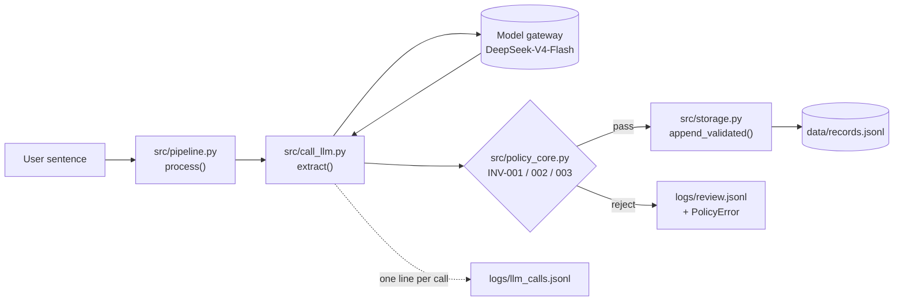

# CS5351 Agentic Software Engineering Project — Team Report

**Project:** AI-Powered Personal Finance Assistant — one natural-language sentence in, one validated spending record out.
**Repository:** https://github.com/Felix-Free/AI-Finance-Assistant
**Course:** CS5351 Agentic Software Engineering · City University of Hong Kong
**Submission date:** `<YYYY-MM-DD>`
**Word count (excluding diagrams and tables):** `<n>` / 10,000 · **Pages (Point 12, single spacing):** `<n>` / ≥ 15

---

## Team

| Role | Member | Student ID | Owned deliverables | Contribution weight |
|---|---|---|---|---|
| A — Leader | Tan Jingling | 60528523 | Integration, cross-review, `Report.md`, `Prompt.md`, repo/CI configuration | `<w>` |
| B — Requirements & Architecture | Qingzhi Lu | 60357951 | D1 requirements, D2 architecture artefacts, trace matrix | `<w>` |
| C — Security & Policy | Qiang Wanyun | 60339160 | Invariants, runtime policy catalog, permission model, governance rules | `<w>` |
| D — Implementation | Liu Wanyang | 60915652 | `src/**`, storage, measurement scripts, ADRs, memory design | `<w>` |
| E — Verification & QA | Chen Guanyu | 61049313 | `test/**`, six CI gates, review memo, bug diary, debt register | `<w>` |

> **Relative contribution** is computed from the recorded effort table in §12 (mean = 1.0; a member's weight = their total hours ÷ the team mean). Populate the table before submission and carry the weights into this table.

---

## How to use this framework — delete this whole block before submission

Every section below states **who writes it**, **how long it should be**, **which evidence it must cite**, and **what a grader will look for**. Fill the prose under each heading; keep the citations. The framework is a scaffold, not a text to polish.

| § | Section | Owner | Words | Hard dependency |
|---|---|---|---|---|
| 1 | Introduction and project overview | A | 650 | — |
| 2 | Team, roles and the engineering process | A | 850 | §6 numbers from E |
| 3 | Requirements engineering and requirement volatility | B | 950 | — |
| 4 | Architecture and design decisions | C (4.1–4.3), B (4.4) | 1,050 | — |
| 5 | AI-assisted construction and prompt evolution | A (5.1, 5.3), D (5.2) | 1,150 | §4, §6 |
| 6 | Verification and quality governance | E (6.1–6.2, 6.4), D (6.3) | 1,150 | — |
| 7 | Human oversight: what the agent got wrong | A (lead) + all | 950 | §5, §6 |
| 8 | Artifact co-evolution | B | 500 | §3, §4, §6 |
| 9 | Limitations, risks and what we would change | C | 400 | §6, §9 risk list |
| 10 | Discussion and conclusions | A | 250 | all |
| 11 | Individual self-reflections | each member | 350 each | — |
| 12 | Relative contribution table | A | — (table) | owner hours |

**Non-negotiable rules for every author**

1. **No invented evidence.** Never write a number, a pass, or a measurement that was not observed. If something is unverified, write "not verified" and say why — the course rewards honest reporting far more than a clean-looking claim.
2. **Cite the artefact inline**, not only in a reference list: `docs/architecture/adr/003-atomic-append-and-locking.md`, `docs/bug-diary.md#BUG-03`, `PR #30`, `ADR-002`. A claim without a pointer is worth nothing in this report.
3. **Keep the four mandatory D6 elements intact:** (a) all names and student IDs, (b) the relative-contribution table, (c) requirement-volatility / defect-trend / ambiguity evidence, (d) one 300–500 word self-reflection per member.
4. **Do not exceed 10,000 words** excluding diagrams and tables. The word budget above sums to ≈ 9,650 so there is room to breathe, not room to expand.
5. **Diagrams and tables do not count.** Use them aggressively; use prose where an argument must be made.

---

## 1. Introduction and project overview

*Owner: A · ≈ 650 words · Cite: `README.md`, `docs/req/requirements.yaml` (`scope`, `non_goals`), `architecture-blueprint.md` §1.*

**What this section must establish.** A reader who has never seen the repository should understand, after one page, what the application does, why an LLM is in the loop at all, and where the safety boundary sits.

- **The problem.** One sentence — e.g. "spent 350 HKD on groceries" — is what a user actually types; a ledger needs `amount`, `category`, and a budget check. The gap between the two is the product.
- **The one-line architecture.** Model parses → `src/policy_core.py` validates → accept / reject / review. State the thesis explicitly: **the model proposes, code disposes.**
- **Why this is a genuine AI component, not AI decoration.** The extraction is genuinely linguistic (free-form Chinese/English, implicit amounts, aliases such as "groceries" for `food`); a regex would visibly fail on the corpus in `test/live/test_live_model.py`.
- **Scope and non-goals.** Quote the registry's `non_goals` (`NG-1`..`NG-6`): no bank connections, no payments, no investment advice. Saying what the system refuses to do is part of the design.
- **Deliverable map.** One short paragraph or table mapping the course deliverables D1–D9 to their files, so the rest of the report can refer to `D1`..`D9` without re-explaining.

**Figure 1 — the two-half architecture** (replace the skeleton below with the final diagram; keep it under ~12 nodes).

---

## 2. Team, roles and the engineering process

*Owner: A · ≈ 850 words · Cite: `AGENTS.md`, `docs/architecture/permission-model.md`, `.github/workflows/ci.yml`, `docs/ai-use-log.yaml`, git history.*

**What this section must establish.** The process is the object being graded, so describe it as a mechanism, not as a mood.

- **Roles and rotation.** A (leader, integration and cross-review), B (requirements/architecture), C (security/policy), D (implementation), E (verification/QA). State whether you rotated, and be specific about who reviewed whose PR — the repository has review evidence per role, e.g. A's transcript rejecting PR #10 and PR #11.
- **The three phases and their gates.** Phase 1 built the skeleton and the governance documents; Phase 2 built the deterministic core, storage, CI and the six gates; Phase 3 hardened concurrency, the test-approval gate, and the AI-use log. 166 commits and 33 merge commits between 2026-11-06 and 2026-11-21 are the raw evidence — a timeline table (date → milestone → PR) is stronger than prose here.
- **The per-task protocol.** Plan → human approval → implement → verify → report, with the `CHANGED FILES` block as the audit hook (`AGENTS.md` §2). Explain *why* the plan is a separate artefact: it is the only point where a human can stop an agent cheaply.
- **Ownership vs. write permission.** These are different controls and the project treats them differently: a role *owns* a document, but the agent's *write* capability is a whitelist (`docs/architecture/permission-model.md` §2, `.opencode/permissions.jsonc`). Default deny; secrets unreadable; `.github/**` human-only.
- **How the process was optimized over time.** Pick two or three concrete optimizations rather than a list: (i) the AI-use log became a blocking gate instead of an honour system; (ii) the test-approval gate was moved from self-discipline to machine enforcement after it was shown to be bypassable; (iii) review was parallelised by role, with A as the merge bottleneck. Say what each change cost and bought.

**Figure 2 — phase timeline** (optional; a table is equally acceptable).

---

## 3. Requirements engineering and requirement volatility

*Owner: B · ≈ 950 words · Cite: `docs/req/requirements.yaml`, `docs/req/req-schema.json`, `docs/architecture/trace-matrix.md`, `PD-001`..`PD-008`.*

**What this section must establish.** The course asks specifically for **requirement volatility** and **ambiguity resolution** as process-quality evidence. Both must be quantified, not asserted.

### 3.1 A machine-readable registry

- **Structure.** 36 formal requirements: 8 `FR`, 7 `NFR`, 3 `INV`, 8 `AI-REQ`, 5 `ERR`, 5 `SEC`. Each has an ID, a type, a statement, a **machine-checkable fit criterion**, a MoSCoW priority, and an owner.
- **Why machine-readable matters.** The registry is validated in CI by a Draft 2020-12 schema (Gate 3) and joined to tests by the trace matrix. A requirement that cannot be validated is a wish; a requirement whose test is missing is a visible gap.
- **Two honest features to highlight.** (i) `status: pending_confirmation` is a first-class state — 8 open decisions `PD-001`..`PD-008` are recorded rather than resolved by assumption; (ii) the model-id discrepancy (`deepseek-v4-flash` in the brief vs. `CS5351/DeepSeek-V4-Flash` configured) is carried as a known difference instead of being silently normalised.

### 3.2 Requirement volatility — quantify it

Build a small table; the numbers below are from the repository at the time of writing — re-derive them on submission day and say so.

| Metric | Value | Evidence |
|---|---|---|
| Formal requirements at submission | 36 | `trace-matrix.md` §4 |
| Requirements added after Phase 1 | `<n>` | git history of `requirements.yaml` |
| Requirements reworded / split | `<n>` | `4f346b7`, `06c41d1` (identifier rename), `dee59f7` (NFR-007 testability) |
| Requirements withdrawn | `<n>` | — |
| Formal open decisions (`PD`) | 8 | `requirements.yaml::pending_decisions` |
| Verification status: implemented & tested | 22 | `trace-matrix.md` §4.3 |
| Verification status: implemented, not tested | 5 | same |
| Verification status: partially implemented | 6 | same |
| Verification status: not verified | 3 | same |

- **The identifier rename is the best volatility story you have.** `C-INV-###` was renamed to `INV-###` across requirements, architecture and code (`4f346b7`, `06c41d1`). Explain the cost: every downstream reference had to be found, and a partial rename would have made the trace matrix lie. Then explain the fix: the registry became the naming authority and Gate 3 revalidated after the rename.
- **Separate drift from decision.** A requirement that changed because a human re-decided is healthy; one that changed because an agent found the spec ambiguous is a defect. Label each change accordingly.
- **Also state what did *not* change and why** — the three invariants `INV-001/002/003` never moved after Phase 1, which is evidence that the safety boundary was specified well enough up front.

### 3.3 Ambiguity resolution

- Walk through **three** `PD` items end to end: what was ambiguous, who owned it, how it was resolved (or why it is still open), and what would happen if it were resolved the other way. Good candidates: `PD-002` category-whitelist finality, `PD-003` budget value and storage, `PD-007` latency/token thresholds.
- Show the **ambiguity → artefact** loop: an ambiguity found during review becomes a `PD`, a `PD` becomes either a requirement change or a documented risk, and the change is revalidated by Gate 3. This loop is the answer to "how did you keep requirements honest?".
- Be explicit that an unresolved `PD` is **not** a pass — the registry says so, and the report must not imply otherwise.

---

## 4. Architecture and design decisions

*Owner: C for 4.1–4.3, B for 4.4 · ≈ 1,050 words · Cite: `architecture-blueprint.md`, `docs/architecture/adr/*.md`, `docs/architecture/invariants.md`, `runtime-policy-catalog.md`, `memory-design.md`.*

### 4.1 The authority boundary

- **Advisory vs. authoritative.** The model's output is data, never authority. Name every place where the boundary is enforced: `policy_core.validate_record` before any write, `storage.append_validated` re-validating, and the rule that no prompt text is allowed to enforce a business rule.
- **Candidate generation and evaluation.** The architecture was chosen from candidates, not asserted: cite `docs/architecture/evaluation-table.md` (the comparison) and `option-ledger.md` (what was rejected and when it should be reconsidered). Two rejected options are worth naming, with the criterion that killed them.

### 4.2 Decisions that were actually hard

Use the ADRs as the spine; one paragraph each, no more.

- **ADR-001 — layered context structure.** What the model receives on every turn (identity, standing constraints, retrieved knowledge, history, task), the assembly pipeline, and the re-injection rule for constraints after compaction.
- **ADR-002 — token-budget cap.** The cap, the compaction threshold, and what is dropped first. Tie it to `NFR-001`/`NFR-002` being *threshold-pending* rather than pretend a budget was measured.
- **ADR-003 — atomic append and locking.** The best-evidenced decision in the project: E reproduced a lost record and a 16-byte partial write, D implemented atomic replacement plus a writer lock, C confirmed the two open questions, and the ADR records the rejection of a silent fallback. Use it to show that an ADR is a decision record, not a description.

### 4.3 Invariants and degradation behaviour

- `INV-001` positive amount ≤ 2 decimals, `INV-002` closed category whitelist, `INV-003` cumulative spend ≤ budget. For each: statement, enforcing function, verification method, and the **operational fallback** if it is ever violated.
- `RP-001`..`RP-007`: what the system does when degraded (transport failure, non-JSON output, logging failure). The fail-closed direction is the point: when in doubt, deny.
- **Permission model.** Default deny, every path whitelisted, secrets unreadable. Explain the exception process (`AGENTS.md` §3) and why an agent cannot grant itself one.

### 4.4 Traceability

- Present the trace-matrix contract: every formal requirement maps to an enforcing component, a test, and a runtime monitor. Give the current distribution (22 / 5 / 6 / 3) and name the three `NOT_VERIFIED` rows honestly (`NFR-001`, `NFR-002`, `INV-PENDING-01`).
- **The Runtime Monitor column is empty by design** — the repository says no continuous monitor exists. Say that, and say whether that is acceptable for a course prototype. Do not invent a monitor.

---

## 5. AI-assisted construction and prompt evolution

*Owner: A for 5.1 and 5.3, D for 5.2 · ≈ 1,150 words · Cite: transcripts, `prompts/prompt_v1.1.yaml`, `src/call_llm.py`, `AGENTS.md` §5, PR history.*

### 5.1 The supervised construction pipeline

- **What the agent was allowed to do**, and the four hard limits: never change the model, never bypass `policy_core`, never write a secret, never touch a path outside the whitelist. These are code-and-config constraints, not prompt requests — that is the course's central point.
- **How a task actually ran.** One worked example, start to finish: the plan the human approved, the diff the agent produced, the review that rejected part of it, and the final `CHANGED FILES` block. Pick a small task (a guard, a test) so the example fits in half a page.
- **Scale, with numbers.** 166 commits / 33 merges over 16 days, 74 tracked files, 36 requirements, 9 D-artefacts, 6 CI gates, 61 logged AI sessions. Numbers are the cheapest credibility available; every one must be derivable from the repo.

### 5.2 Prompt evolution: v1.0 → v1.1

This is the report's cleanest "AI hallucinated, human fixed it" case, and it should be told as a measurement, not an anecdote.

- **v1.0** asked for a JSON object with `amount` and `category`, with no vocabulary and no output discipline.
- **Observed failure.** The live model returned `transportation` instead of `transport` and `groceries` instead of `food`. Because `INV-002` enforces a closed whitelist, these were *correctly rejected* — the safety layer worked — but each rejection burned a round trip and pushed the user into the review path.
- **v1.1** pins the output shape (single JSON object, no prose, no fences), quotes the exact whitelist, states the amount rules, and defines what to do with non-spending text. Note the important constraint: the prompt now *describes* the rules but still does not *enforce* them — `policy_core` remains the only enforcement point.
- **Two lessons worth stating.** (i) A prompt is a specification with a token cost; making it stricter converted a correctness problem into a cheaper one. (ii) The anti-hallucination fix was only safe because the deterministic layer already rejected the hallucination — the order of the two layers is what made the failure survivable.

### 5.3 Review as a product, not a formality

- The review checklist that matters: does the plan match the diff, does `CHANGED FILES` match `git status`, was a read-only path touched, does the new test fail without the guard, is any rule enforced by prompt text. Each of these has caught something real — cite one case per item from `docs/review-memo.md` and the transcripts.
- **Review verdicts are not always APPROVE.** The review memo records `CHANGES REQUIRED` for PR #18 and PR #19 and keeps the two open findings visible. Say so; a report that only shows approvals is not credible.

---

## 6. Verification and quality governance

*Owner: E for 6.1, 6.2 and 6.4; D for 6.3 · ≈ 1,150 words · Cite: `.github/workflows/ci.yml`, `.github/ci_checks.py`, `test/**`, `docs/measurements/`, `docs/bug-diary.md`, `docs/debt-register.md`.*

### 6.1 The six blocking gates

One short subsection per gate: what it blocks, how it decides, and its known weakness. Do not describe them as uniformly strong — the weakest ones are the most interesting.

| Gate | Blocks | Mechanism | Known weakness |
|---|---|---|---|
| 1 · test-approval | implementation without a prior human approval on the test commit | reads GitHub review state | required-check enforcement unverified (`DEBT-08`); #32 was merged while it was red |
| 2 · static-analysis | lint/type/secret regressions | ruff, mypy 1.8, `pip check`, secret scan, API-surface and permission checks | mypy target is `src` only |
| 3 · schema-validation | a registry that no longer validates | Draft 2020-12 validation of `requirements.yaml` | validates shape, not meaning |
| 4 · semantic-eval | a prompt/model change that degrades extraction quality | live suite in the protected `semantic-eval` environment | runs only when Gate 1 flags a semantic change; credentials are the single point of failure |
| 5 · offline-regression | any regression in the deterministic suite | full offline pytest run | offline only — network paths are simulated |
| 6 · ai-use-log | a code/prompt change with no logged session | append-only check on `docs/ai-use-log.yaml` | verifies presence and immutability, not quality of the entry |

### 6.2 Enforcement versus intention

- State plainly that **the six checks are intended required checks, but required-check enforcement for `main` is unverified** (`DEBT-08`), and that PR #32 was admin-merged while Gate 1 was red. Then say what that means: the *pipeline* is implemented and demonstrated; the *branch protection* is a configuration step that was not proven.
- This is the single most important honesty paragraph in the report. A grader who checks the repository will find `DEBT-08`; a report that claims enforced branch protection will be caught.

### 6.3 What was actually run

Give a results table with **command, environment, result, and date** for each row. Suggested rows:

- `pytest test/offline -q` — local, network blocked — `<n> passed` (last recorded on `main 35f580d`: 211 passed; 216 on PR #36's head).
- `pytest test/live/test_live_model.py` — protected environment — 5 passed on the PR #20 path.
- `mypy --disable-error-code import-untyped src` — 8 source files clean.
- `ruff check --select E9,F63,F7,F82` — clean.
- Gate 3 schema validation — pass; deleting a required field fails.
- Guard-removal negatives — one per invariant, each fails when its guard is removed.

Then the **unverified** list, which is part of the deliverable: merge-time live execution, required-check enforcement, a genuinely blocked PR, and an end-to-end test-first review on GitHub.

### 6.4 Defect trends and the debt register

- **Four defects, four different failure modes.** `BUG-01` a gate that accepted a docs-only approval; `BUG-02` an offline test writing into `logs/`; `BUG-03` a 16-byte partial append; `BUG-04` an uncleaned HTTP error body reaching the call log. Plot or tabulate them by discovery phase and by how they were found (agent self-report vs. human review vs. adversarial test).
- **The trend to argue.** Early defects were specification gaps; later ones were concurrency and secrecy failures — i.e. the agent's bugs moved from "wrong feature" to "wrong under stress", which is exactly where human review adds the most. Support this with the `BUG-0x` sequence, not with adjectives.
- **`DEBT-01`..`DEBT-08` mapped to the eight AI-era categories** (prompt rot, hallucinated dependencies, untouchable code, hidden dependencies, agent-induced bloat, evaluation debt, guardrail debt, human/cognitive debt). Name which categories are *active* (guardrail, evaluation, human/cognitive, prompt rot) and which are *monitored* with no reproduced item. The distinction is the point: "monitored" is not "clean".

---

## 7. Human oversight: what the agent got wrong

*Owner: A (lead), each member contributes one vignette · ≈ 950 words · Cite: transcripts, PR review threads, `docs/bug-diary.md`.*

**What this section must establish.** The course asks what human oversight caught that the agent did not. Answer with incidents, not with a claim of vigilance. Each vignette should be 120–180 words and follow the same shape: **what the agent produced → what it missed → how the human found it → what changed in the process afterwards.**

Candidate vignettes (pick five; do not use all of them, and drop any you cannot cite):

1. **The missing governance directories.** The generated skeleton omitted `.github/workflows`, `.opencode` and `.agent`; the human added them by hand because the agent optimised for the files it was told about. Process change: the required tree became a checked artefact.
2. **The CI that could not validate requirements.** Gate 3 failed because the registry was still unmerged; the agent's own PR looked broken while the real fault was cross-role ordering. The leader merged in the right order instead of asking for a rewrite.
3. **The test-first gate that accepted a docs-only approval** (`BUG-01`). The gate was "implemented and green" and still wrong; only adversarial review found the false accept.
4. **The offline test that wrote to `logs/`** (`BUG-02`). A passing suite that mutated runtime state — invisible until someone looked at the filesystem, not the exit code.
5. **The 16-byte partial write and the lost record** (`BUG-03`, `ADR-003`). The agent implemented an atomicity claim; concurrent writers still lost records. The human demanded a reproducible test before accepting the fix.
6. **The uncleaned HTTP error body** (`BUG-04`). A synthetic marker made a real secrecy defect visible; the rule that came out of it is general, not test-specific.
7. **The docs-only approval / admin merge on #32.** A human decided to merge while a gate was red — and then wrote it into `DEBT-08` instead of hiding it. Oversight includes recording your own exceptions.

**Close the section with the generalisation.** What class of failure does an agent produce that a human catches? The report should commit to a view: the agent is locally fluent and globally unaware — it satisfies the sentence it was given and misses the invariant nobody mentioned. Human value sits in *cross-role* and *cross-artefact* consistency, not in line-level correctness.

---

## 8. Artifact co-evolution

*Owner: B · ≈ 500 words · Cite: `trace-matrix.md`, `requirements.yaml` history, `evaluation-logbook.md`, PR #31.*

**What this section must establish.** When anything changed, how did the documents change with it — mechanically, not by good intentions.

- **The rule.** A change to a requirement forces a trace-matrix row, a test, and a doc update in the same PR; Gate 3 and Gate 6 make the registry and the AI-use log un-skippable.
- **Three worked cases.** (i) The `C-INV` → `INV` rename propagated through requirements, invariants, blueprint and code; (ii) the `_append_review` → `_append_rejection` rename in code required the runtime policy catalog to follow; (iii) the measurement scripts moved from `src/` to `scripts/`, and the stale paths in the logbook and policy catalog were caught and corrected (PR #31). Case (iii) is the strongest because it shows a *documentation* defect found by review, not a code defect.
- **Where co-evolution failed.** Name at least one place where a document lagged the code — the evaluation logbook still cites `python -m src.measure_latency` on `main`, and `NFR-001`/`NFR-002` remain `pending` with no committed measurement. A co-evolution section with no failure is not believable.
- **The mechanism that made it stick.** The AI-use log entry is required for any `src/`, `test/`, `prompts/`, `.github/` or `scripts/` change; the trace matrix is the join key between prose and tests. Both are checkable in CI, which is why they survived contact with a deadline.

---

## 9. Limitations, risks and what we would change

*Owner: C · ≈ 400 words · Cite: `docs/architecture/risk-list.md`, `debt-register.md`, `trace-matrix.md` §5.*

- **Technical limits.** No persistence of the budget itself (`PD-003`); no continuous runtime monitor; live evaluation gated behind a protected environment, so a prompt regression can sit unmeasured.
- **Process limits.** Required-check enforcement unproven (`DEBT-08`); a human can still admin-merge a red PR; the AI-use log proves presence, not quality.
- **Measurement limits.** No committed latency or token evidence (`NFR-001`/`NFR-002` pending, `PD-007`). Say what a real measurement would require and why it was not done.
- **What we would change with another sprint.** Two or three concrete changes, ordered by value: configure the six checks as required; commit a measurement run and a baseline; add the missing role-B AI-use entries and the fifth transcript. Do not list everything — prioritise.

---

## 10. Discussion and conclusions

*Owner: A · ≈ 250 words · Cite: everything above.*

- **What the project demonstrates.** A working, tested, gated AI feature whose safety does not depend on the model behaving.
- **What it demonstrates about agentic engineering.** The interesting work is not generating code; it is building the constraints, the evidence trail, and the review habits that make generated code acceptable. The project's artefacts — registry, trace matrix, six gates, ADRs, bug diary, debt register — are that argument made concrete.
- **One sentence a grader should remember.** Leave them with the thesis: *the model proposes, code disposes, and humans own the difference.*

---

## 11. Individual self-reflections

*Each member: 300–500 words, first person, signed with name and student ID. Answer (a) what you personally built, (b) one decision you made against the agent's suggestion and why, (c) one thing you got wrong, (d) what you now believe about supervising an AI coding agent that you did not believe in week 1. Do not describe the project; describe your judgement.*

### 11.1 Tan Jingling — 60528523 (Role A, Leader)

`<300–500 words>`

### 11.2 Qingzhi Lu — 60357951 (Role B, Requirements & Architecture)

`<300–500 words>`

### 11.3 Qiang Wanyun — 60339160 (Role C, Security & Policy)

`<300–500 words>`

### 11.4 Liu Wanyang — 60915652 (Role D, Implementation)

`<300–500 words>`

### 11.5 Chen Guanyu — 61049313 (Role E, Verification & QA)

`<300–500 words>`

---

## 12. Relative contribution

*Owner: A · table only — tables are excluded from the word count.*

**Method.** Each member records productive hours per phase (agreed in advance, not reconstructed afterwards). `Mean = total ÷ 5`. `Weight = member total ÷ mean`. Weights are carried into the Team table on page 1 and pro-rate individual marks, as the course brief requires.

| Member | ID | Phase 1 | Phase 2 | Phase 3 | Final integration | Total | Weight |
|---|---|---|---|---|---|---|---|
| Tan Jingling | 60528523 | `<h>` | `<h>` | `<h>` | `<h>` | `<H>` | `<w>` |
| Qingzhi Lu | 60357951 | `<h>` | `<h>` | `<h>` | `<h>` | `<H>` | `<w>` |
| Qiang Wanyun | 60339160 | `<h>` | `<h>` | `<h>` | `<h>` | `<H>` | `<w>` |
| Liu Wanyang | 60915652 | `<h>` | `<h>` | `<h>` | `<h>` | `<H>` | `<w>` |
| Chen Guanyu | 61049313 | `<h>` | `<h>` | `<h>` | `<h>` | `<H>` | `<w>` |
| **Mean** | | | | | | **`<H>`** | **1.00** |

> State the weighting rule in one sentence above the table and the *evidence* for the hours (GitHub contributions, PR authorship, review counts) in one sentence below it. A table with neither is an assertion.

---

## Appendix A — Evidence index

*Owner: A · tables and links, excluded from the word count.*

| Deliverable | Artefact(s) | Status at submission |
|---|---|---|
| D1 requirements | `docs/req/requirements.yaml`, `docs/req/req-schema.json` | `<status>` |
| D2 architecture (11 artefacts) | `architecture-blueprint.md`, `docs/architecture/**` | `<status>` |
| D3 coding governance | `AGENTS.md`, `docs/code-governance/**`, `.opencode/**`, `.agent/rules.md` | `<status>` |
| D4 verification governance | `docs/code-governance/verification-constraints.md`, `review-memo.md`, `debt-register.md`, `bug-diary.md` | `<status>` |
| D5 transcripts (5, annotated) | `transcripts/**` | `<status>` |
| D6 report | this file | `<status>` |
| D7 GitHub repository | `.github/workflows/**`, branch protection | `<status>` |
| D8 source and tests | `src/**`, `test/offline/**`, `test/live/**` | `<status>` |
| D9 static prompt | `Prompt.md`, `prompts/prompt_v1.0.yaml`, `prompts/prompt_v1.1.yaml` | `<status>` |

## Appendix B — Links

- Repository: https://github.com/Felix-Free/AI-Finance-Assistant
- CI run, `main` (all offline tests + static analysis): https://github.com/Felix-Free/AI-Finance-Assistant/actions/runs/44677721024
- Gate 4 protected-environment run (PR #20): https://github.com/Felix-Free/AI-Finance-Assistant/actions/runs/43862856085
- Gate 1 failure accepted on PR #32 (admin merge): https://github.com/Felix-Free/AI-Finance-Assistant/actions/runs/44561573231
- Test-first approval recorded on PR #30: https://github.com/Felix-Free/AI-Finance-Assistant/pull/30#pullrequestreview-5972571059
