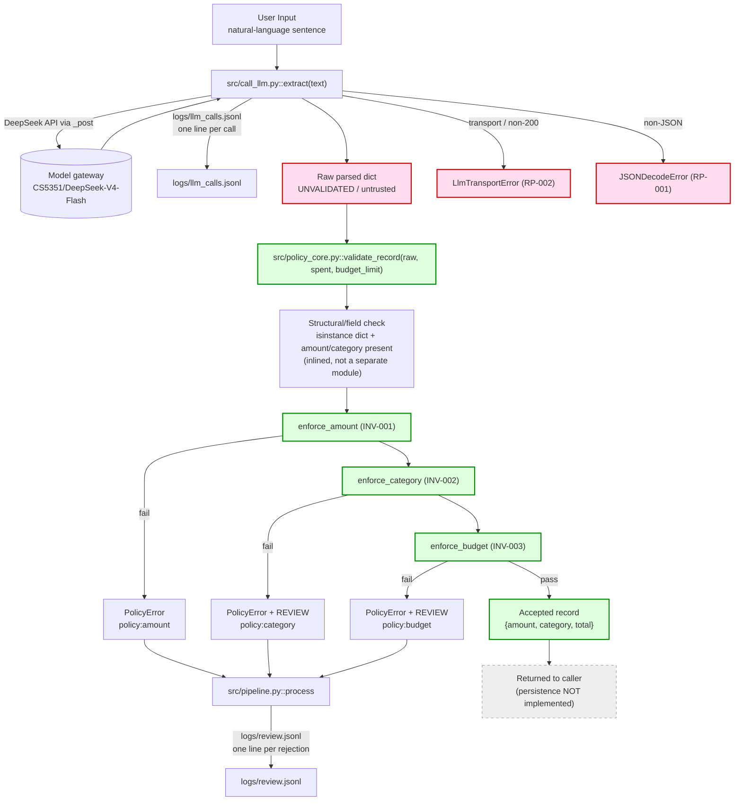
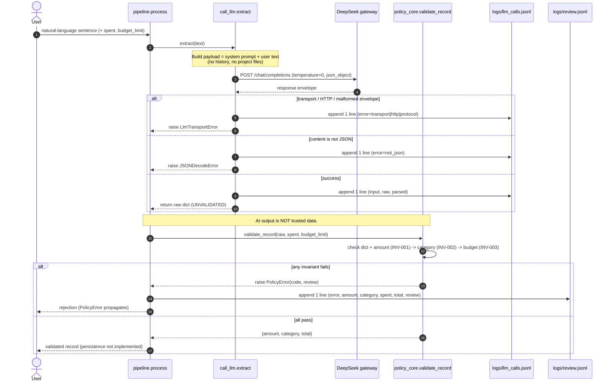

# Architecture Blueprint — AI Finance Assistant

> Owner: Role B (Requirements & Architecture)
> Status: **Phase 1 · D2 draft.** This document describes the system AS IT ACTUALLY IS,
> separating **implemented**, **designed-but-not-implemented**, and **not-approved**.
> It does not create ADRs (Phase 2) or the Trace Matrix (Phase 3).
>
> Companion documents (authoritative for their scope, not redefined here):
> - `docs/architecture/invariants.md` (INV-001/002/003) — role C
> - `docs/architecture/runtime-policy-catalog.md` (RP-001..RP-006) — role C
> - `docs/architecture/permission-model.md` — role C
> - `requirements.yaml` — role B (functional / non-functional requirements)
> - `AGENTS.md` — the agent contract
> - `docs/code-governance/structural-constraints.md` — naming and module boundaries
>
> Code references below are to the real files. All referenced code (`src/call_llm.py`,
> `src/policy_core.py`, `src/pipeline.py`) is merged on `main` as of PR #9. Tests live in
> `test/offline/`. CI is not yet set up.

---

## 1. System Overview

### 1.1 Background

A graduate Software Engineering project. A user describes a purchase in natural language
(e.g. `"昨晚吃火锅花了 350 元"`). The system calls the DeepSeek model to parse it into
structured data, then deterministic code validates the result before it can be trusted.

### 1.2 Core goal

Turn **one natural-language sentence** into **one validated spending record**, while
guaranteeing that the probabilistic model can never decide a safety outcome. AI interprets;
deterministic code decides.

### 1.3 System boundary

- **In boundary:** natural-language input → model parsing → schema/field checks →
  deterministic business-rule validation → accept / reject / review → logging.
- **Out of boundary (current version):** persistence, budget storage, UI, authentication,
  bank connections, payments, investment advice, transfer, financial planning
  (see `requirements.yaml` `scope.non_goals`).

### 1.4 Implementation status (three-state, mandatory distinction)

**A. Implemented** (real code; all merged on `main` as of PR #9):

| Capability | Location |
|---|---|
| Model call + fail-closed call log | `src/call_llm.py::extract`, `_post`, `_append_log` |
| Static system prompt (JSON-only) | `src/call_llm.py::SYSTEM_PROMPT` |
| Deterministic guards | `src/policy_core.py::enforce_amount`, `enforce_category`, `enforce_budget` |
| Combined validation | `src/policy_core.py::validate_record` |
| Orchestration + review log | `src/pipeline.py::process`, `_append_review` |
| Smoke tests | `test/offline/test_policy_core_smoke.py`, `test/offline/test_pipeline_seam.py` |

**B. Designed but NOT implemented:**

- A standalone **Schema Validation** layer (today, structural checks are inlined in
  `validate_record` as `isinstance(raw, dict)` + key access; there is no JSON-Schema
  runtime validator in the request path).
- **Persistence / storage** of accepted records.
- **Budget limit storage/configuration** (`budget_limit` is passed in by the caller today).
- Full boundary test suite `test/offline/test_invariants.py` (role E).
- CI pipeline (`.github/workflows/` contains only `.gitkeep`).
- Externalised / configurable prompt file (`Prompt.md` is still a TODO; the prompt lives
  only in the `SYSTEM_PROMPT` constant).

**C. Not approved / not in scope:** database, front end, user auth, MCP servers, external
services beyond the model gateway, any feature absent from `requirements.yaml`.

---

## 2. Architecture Principles

1. **AI is for Interpretation, Not Authority.**
   The model extracts `amount` and `category`. It never decides acceptance.
   Source: `AGENTS.md §3` ("The model proposes; code disposes"), `ai_requirements AI-REQ-001/002`.

2. **Deterministic Validation over AI Judgment.**
   Every model output passes `policy_core.validate_record` before it can affect data.
   Rules live in code, never in prompt text. Source: `AGENTS.md §3`, `structural-constraints.md §2`.

3. **Least Privilege.**
   The coding agent may write only whitelisted paths; `.env` is unreadable/unwritable;
   `docs/req/**`, `.opencode/**`, `.agent/**`, `.github/**`, `transcripts/**`, `logs/**`
   are read-only or denied. Source: `permission-model.md §2`, `.opencode/permissions.jsonc`.

4. **Human Approval before AI Code Changes.**
   Plan first and wait for approval; one task at a time; end with a `CHANGED FILES` block.
   Source: `AGENTS.md §1`, §7 exception process.

5. **Traceability.**
   Every model call appends exactly one `logs/llm_calls.jsonl` line; every policy rejection
   appends one `logs/review.jsonl` line. Source: RP-004, `invariants.md §2` (option B).

6. **Fail-safe (fail-closed) Behavior.**
   If a call cannot be logged, its result must not be used; on ambiguous/transport failure
   the system refuses rather than guesses. Source: RP-002/RP-004, `call_llm.py::_append_log`.

---

## 3. High-level Architecture

The pipeline is linear. The single crossing point from "probabilistic" to "deterministic"
is the hand-off of the raw parsed dict into `policy_core.validate_record`. **Schema/field
checking is a logical stage inside `validate_record`, not a separate module today.**

**Layer responsibilities**

| Layer | Responsibility | Depends on | Trust |
|---|---|---|---|
| Input | Receive one sentence | — | untrusted (user) |
| Model call (`call_llm`) | Send request, parse envelope, log, fail-closed | `requests`, gateway | produces untrusted output |
| Schema/field check (in `validate_record`) | Reject non-dict / missing fields | `policy_core` | deterministic |
| Policy (`policy_core`) | Enforce INV-001/002/003 | stdlib `decimal`, `math` | authoritative |
| Pipeline (`pipeline`) | Ordering + review logging | `call_llm`, `policy_core` | deterministic |
| Persistence | Store accepted record | — | **not implemented** |

---

## 4. Component Architecture

| Component | Responsibility | Input | Output | Dependencies | Owner | Status |
|---|---|---|---|---|---|---|
| `src/call_llm.py::extract` | Single model entry point; call twice-free, parse JSON, log every path | `text: str` | parsed `dict` (UNVALIDATED) | `_post`, `_append_log` | D | implemented |
| `src/call_llm.py::_post` | HTTP call + envelope parse; converts all transport/protocol failures to `LlmTransportError` | `payload: dict` | raw content `str` | `requests` | D | implemented |
| `src/call_llm.py::_append_log` | Append exactly one JSONL line; fail-closed on OSError | `record: dict` | (writes `logs/llm_calls.jsonl`) | filesystem | D | implemented |
| `src/call_llm.py::SYSTEM_PROMPT` | Static instruction: return only JSON `{amount, category}` | — | prompt string | — | D | implemented (constant) |
| `src/policy_core.py::enforce_amount` | INV-001 guard | amount | amount / `PolicyError(policy:amount)` | `math`, `decimal` | D | implemented |
| `src/policy_core.py::enforce_category` | INV-002 guard | category | category / `PolicyError(policy:category, review=True)` | `CATEGORY_WHITELIST` | D | implemented |
| `src/policy_core.py::enforce_budget` | INV-003 guard | spent, amount, limit | new total / `PolicyError(policy:budget, review=True)` | `decimal` | D | implemented |
| `src/policy_core.py::validate_record` | Structural check + ordered guards | raw, spent, budget_limit | `{amount, category, total}` / `PolicyError` | the guards | D | implemented |
| `src/pipeline.py::process` | Orchestrate extract → validate; write review line on rejection | text, spent, budget_limit | validated record | `call_llm`, `policy_core` | D | implemented |
| `src/pipeline.py::_append_review` | Append one `review.jsonl` line; fail-closed | record | (writes `logs/review.jsonl`) | filesystem | D | implemented |
| Schema Validator (standalone) | Validate JSON against a schema before field checks | raw | pass/fail | — | — | **planned, not implemented** |
| Persistence | Store accepted records | record | stored | — | — | **not implemented** |
| Budget store | Provide `budget_limit` | — | limit | — | — | **not implemented** |
| Full boundary tests | Exhaustive INV boundary suite | — | tests | `pytest` | E | **planned** |
| CI | Run `pytest test/offline` on PRs | — | pass/fail | GitHub Actions | E | **not implemented** |

> The `Parser` in the requirement wording is `call_llm.extract` (envelope→JSON) plus the
> inlined field extraction in `validate_record`; there is no separate parser module.

---

## 5. Data Flow

The two log files are disjoint: `llm_calls.jsonl` has exactly one line per model call
(RP-004); `review.jsonl` has exactly one line per policy rejection. A rejection does **not**
add a second `llm_calls.jsonl` line.

---

## 6. Deterministic Safety Boundary

The AI layer and the policy layer are separated by a single API boundary:
`call_llm.extract` returns an **unvalidated** dict; `policy_core.validate_record` is the only
place that decides an outcome. This mirrors `AGENTS.md §3` and `structural-constraints.md §2`.

**The AI MAY:**
- Parse natural language.
- Extract amount and category.
- Return a structured JSON object.
- Resolve language ambiguity within the prompt's output contract.

**The AI MUST NOT:**
- Decide whether to bypass the amount check.
- Modify any invariant.
- Change the budget threshold.
- Decide whether a safety rule may be violated.
- Write a trusted record directly, bypassing the pipeline.

**Rules (owned by C — referenced, not redefined):**

| ID | Rule (from `invariants.md`) | Enforced by |
|---|---|---|
| INV-001 | amount is a finite positive number, ≤ 2 decimals | `enforce_amount` |
| INV-002 | category in code-defined closed whitelist | `enforce_category` |
| INV-003 | cumulative spend ≤ budget; equality allowed | `enforce_budget` |

Degradation follows RP-003/RP-005/RP-006; logging follows RP-004. Category and budget
rejections set `review=True`; amount rejection sets `review=False` (per `invariants.md §2`).

---

## 7. AI Context Assembly Pipeline

This describes what the model is given, its sources, priority, and trust level.
**Current reality:** only a static system prompt + the user sentence are sent. There is
**no** history assembly and **no** project-file injection today; the "assembly" below is the
design intent for later versions, clearly marked.

| # | Context class | Source (real) | Priority | Trust | Injected today? |
|---|---|---|---|---|---|
| 1 | Static System Instructions | `call_llm.py::SYSTEM_PROMPT` | highest | trusted (code-owned) | Yes |
| 2 | Approved Project Requirements | `requirements.yaml`, this blueprint | high | trusted | No — not sent to model |
| 3 | Relevant Business Rules | `invariants.md` INV-001/002/003 | high | trusted | No — enforced in code, not prompt |
| 4 | User Input | the sentence | lowest | **untrusted** | Yes (as a `user` message) |
| 5 | Structured Output Requirements | system prompt + `response_format={"type":"json_object"}` | high | trusted (code-owned) | Yes |

**Selection principle (design, not yet implemented):** include only context relevant to the
current record; never dump the entire transcript or the whole repository. Business rules
are **never** the model's job to apply (§6) — they are executed by code, so they do not need
to be (and currently are not) injected as prompt text.

**Trust boundary:** classes 1/2/3/5 are trusted and code-owned; class 4 is untrusted user
data and must remain subordinate to class 1. Anything that would let class 4 redefine the
output contract is a prompt-injection attempt (§9).

---

## 8. Token Compression Strategy

**Why compression exists:** context is finite and paid for; unbounded history increases cost
and dilutes the instructions.

**Design (stated; NOT implemented — there is no compression code today):**

- **Selection:** keep only context needed to parse the current sentence. Because business
  rules are enforced in code, they are not prompt overhead — removing them from the prompt
  does not weaken safety.
- **De-duplication:** avoid repeating identical system instructions across turns.
- **History limit:** cap carried history (value **pending**, see below).
- **Safety-rule protection:** the rules that matter for safety live in `policy_core`, not in
  the prompt. Therefore token pressure **cannot** relax a safety rule — the protection is
  architectural (rules in code), not textual. The static system prompt must never be dropped
  below its full form, because it defines the output contract.
- **Token budget:** **not defined.** Thresholds are `pending_confirmation`.
- **At budget limit:** specified behaviour is **not implemented**; the safe default is to
  truncate optional context (history/project files) first and never the system instructions,
  then parse as usual. This is a design proposal, not current behaviour.

**Pending token decisions (owner):**

| Item | Status | Owner |
|---|---|---|
| Per-request token ceiling | pending_confirmation | B (`requirements.yaml` PD-007 / NFR-002) |
| Per-session token budget | pending_confirmation | B (PD-007) |
| Max carried history length | pending_confirmation | B |
| Behaviour at limit (truncate/reject/retry) | pending_confirmation | B with C |

> Do not treat any number here as approved; none is set.

---

## 9. Prompt Injection Defense Strategy

Threat: the user sentence contains instructions that try to override the system prompt, alter
rules, or smuggle a fake "accepted" result.

| Defense | Mechanism | Implemented? |
|---|---|---|
| User input is untrusted data | sent as a `user` role message, never merged into system instructions | Yes (structural) |
| User cannot override system instructions | system + user are separate messages; `temperature=0`; output contract fixed | Partial — separation is structural; explicit delimiter/escaping of user text **not** implemented |
| User cannot change business safety rules | rules are in `policy_core` code, not prompt | **Yes** (code-enforced) |
| AI output is not trusted data | `extract` returns "UNVALIDATED"; only `validate_record` accepts | **Yes** (code-enforced) |
| Structured output must be validated | `isinstance(raw, dict)` + field guards before use | **Yes** (in `validate_record`) |
| Deterministic rules executed by code | `enforce_amount/category/budget` | **Yes** |
| AI uncertainty → safe failure | non-JSON / transport / malformed envelope raise; nothing is fabricated | **Yes** (RP-001/RP-002) |

**Design-only additions (not implemented):** explicit quoting/escaping of user input,
a stated instruction that user text is data, and adversarial prompt-injection tests.

---

## 10. Error Handling and Failure Modes

All behaviours below are the real, implemented ones unless marked. Sources: RP-001..RP-006,
`call_llm.py`, `policy_core.py`, `pipeline.py`.

| # | Trigger | Detection layer | Expected behaviour | Logging | Recovery / fallback |
|---|---|---|---|---|---|
| 1 | API request fails (network) | `_post` → `requests.RequestException` | raise `LlmTransportError` | `llm_calls.jsonl` error=`transport: ...` | none (no retry) — RP-002 |
| 2 | Network timeout | `_post` (timeout=30) | raise `LlmTransportError` | `llm_calls.jsonl` error=`transport: ...` | none — RP-002 |
| 3 | Model returns invalid JSON | `extract` → `json.loads` | raise `JSONDecodeError` | `llm_calls.jsonl` error=`not_json`, `parsed=null` | none — RP-001 |
| 4 | Malformed response envelope (200) | `_post` key access | raise `LlmTransportError("protocol: ...")` | `llm_calls.jsonl` error=`protocol: ...` | none |
| 5 | Record not a dict / field missing | `validate_record` | raise `PolicyError(policy:amount, review=False)` | `review.jsonl` one line | record discarded |
| 6 | Type error in amount | `enforce_amount` | `PolicyError(policy:amount)` | `review.jsonl` | discarded — INV-001 |
| 7 | Illegal amount (≤0, >2dp, NaN/Inf) | `enforce_amount` | `PolicyError(policy:amount)` | `review.jsonl` | discarded — INV-001 |
| 8 | Illegal category | `enforce_category` | `PolicyError(policy:category, review=True)` | `review.jsonl` | discarded — INV-002 |
| 9 | Budget exceeded | `enforce_budget` | `PolicyError(policy:budget, review=True)` | `review.jsonl` | discarded — INV-003 |
| 10 | Prompt injection attempt | (not a distinct runtime detector) | neutralised architecturally: user text cannot change code rules; bad output fails validation | normal logs | rules still enforced by code |
| 11 | Schema/field validation failure | inlined in `validate_record` | `PolicyError(policy:amount)` (#5) | `review.jsonl` | discarded |
| 12 | Policy validation failure | `enforce_*` | `PolicyError`: `policy:amount` / `policy:category` / `policy:budget` | `review.jsonl` | discarded |
| 13 | Logging fails | `_append_log` / `_append_review` OSError | raise (fail-closed); result not used | — | abort — RP-004 |

> Note: there is **no** distinct "prompt injection detector" and **no** retry mechanism in the
> code. Do not claim otherwise. Row 10 documents the architectural property, not a module.

---

## 11. Dependencies and Technology Stack

From `requirements.txt` (the only declared dependencies):

| Dependency | Purpose |
|---|---|
| `requests>=2.31` | HTTP to the model gateway (`call_llm` only) |
| `python-dotenv>=1.0` | load `.env` (`BASE_URL`, `API_KEY`, `MODEL`) |
| `pytest>=8.0` | tests under `test/offline` and `test/live` |
| `pyyaml>=6.0` | parse `requirements.yaml` / `ai-use-log.yaml` |

Runtime / stdlib used by code: `json`, `os`, `pathlib`, `sys`, `math`, `decimal`.

**Configuration variables:** `LLM_BASE_URL`, `LLM_API_KEY`, `LLM_MODEL` (default
`CS5351/DeepSeek-V4-Flash`). `.env` is gitignored; `.env.example` holds placeholders.

**Python baseline:** documented as 3.9.7 in `structural-constraints.md §7`, but a 3.14.4 venv
was observed in D's transcript — **pending confirmation (PD-006, owner D).**

**Explicitly absent (do not assume):** database, web framework, auth, MCP servers, message
queue, cache, or any service beyond the model gateway.

---

## Appendix A — Requirement ↔ Component ↔ Invariant coverage

Grounded in `requirements.yaml` (role B) and the real code.

| Requirement | Component | Invariant / Policy | Status |
|---|---|---|---|
| FR-001 | `call_llm.extract` | RP-001, RP-002 | implemented |
| FR-002 | `validate_record` (struct) | INV-001 (dict check) | implemented |
| FR-003 | `enforce_amount` | INV-001 / RP-003 | implemented |
| FR-004 | `enforce_category` | INV-002 / RP-006 | implemented |
| FR-005 | `enforce_budget` | INV-003 / RP-005 | implemented |
| FR-006 | `extract`, `_post` | RP-001, RP-002 | implemented |
| FR-007 | `validate_record` ordering | RP-003 | implemented |
| FR-008 | `_append_log`, `_append_review` | RP-004 | implemented |
| Persistence | — | — | not implemented |
| Budget store | — | INV-003 source | not implemented |
| Full boundary tests | — | INV-001/002/003 | planned (E) |
| CI | — | — | not implemented (E) |

## Appendix B — Open questions handed to others

**To C (`docs/architecture/*`):**
- Confirm the category whitelist is final (PD-002).
- Confirm budget limit value/period/storage (PD-003).
- Confirm retry policy for transport failures (PD-008; currently no retry).
- Confirm `review.jsonl` rejection-evidence contract (already implemented by D as "option B").

**To D (code):**
- Runtime `LLM_MODEL` value (PD-004).
- Python baseline 3.9.7 vs 3.14.4 (PD-006).
- `feat/D-policy-core` merged into `main` as PR #9 (PD-005, resolved).

**To E (tests/CI):**
- Build `test/offline/test_invariants.py` full boundary suite and CI (NFR-007).

**Token budget (owner A/B):** per-request ceiling, per-session budget, max history, at-limit
behaviour — all `pending_confirmation`.
